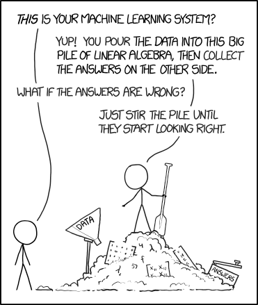
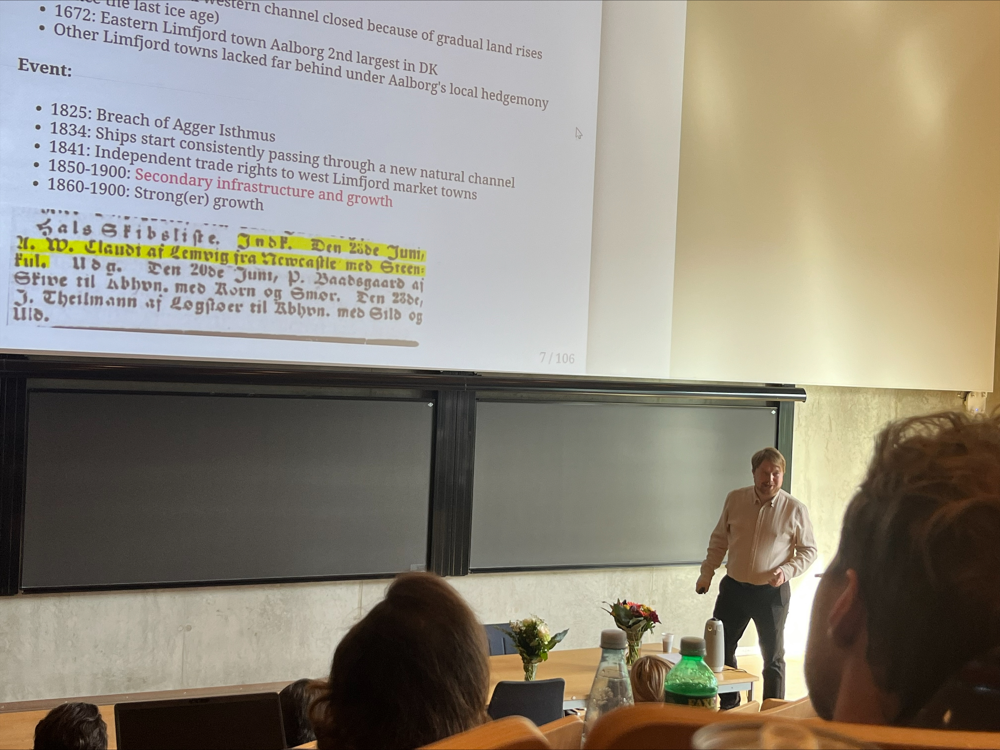
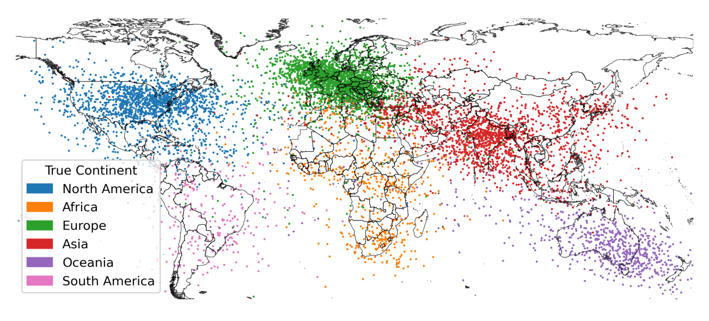
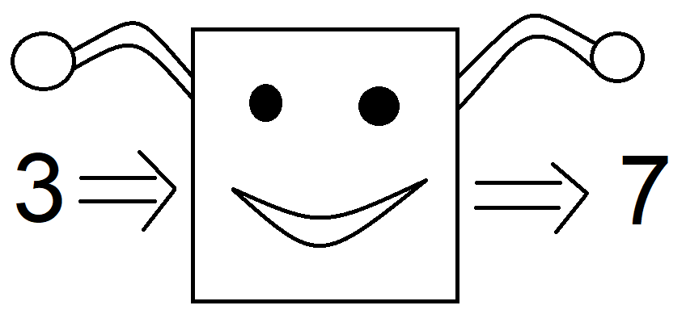

---
output:
  xaringan::moon_reader:
    seal: false
    includes:
      after_body: [insert-logo.html, slide-numbers.html]
    self_contained: false
    lib_dir: libs
    nature:
      highlightStyle: github
      highlightLines: true
      countIncrementalSlides: false
      ratio: '16:9'
editor_options:
  chunk_output_type: console
---
class: center, inverse, middle

```{r xaringan-panelset, echo=FALSE}
xaringanExtra::use_panelset()
```

```{r xaringan-tile-view, echo=FALSE}
xaringanExtra::use_tile_view()
```

```{r xaringanExtra, echo = FALSE}
xaringanExtra::use_progress_bar(color = "#808080", location = "top")
```

```{css echo=FALSE}
.pull-left {
  float: left;
  width: 44%;
}
.pull-right {
  float: right;
  width: 44%;
}
.pull-right ~ p {
  clear: both;
}


.pull-left-wide {
  float: left;
  width: 66%;
}
.pull-right-wide {
  float: right;
  width: 66%;
}
.pull-right-wide ~ p {
  clear: both;
}

.pull-left-narrow {
  float: left;
  width: 30%;
}
.pull-right-narrow {
  float: right;
  width: 30%;
}

.tiny123 {
  font-size: 0.40em;
}

.small123 {
  font-size: 0.80em;
}

.large123 {
  font-size: 2em;
}

.red {
  color: red
}

.orange {
  color: orange
}

.green {
  color: green
}

/* Reflection question, revealed at the end of a slide */
.reflect {
  position: absolute;
  bottom: 95px;
  left: 64px;
  width: 48%;
  padding: 0.3em 0 0.3em 0.6em;
  border-left: 4px solid #808080;
  background: rgba(255, 255, 255, 0.92);
}
.reflect-right {
  position: absolute;
  bottom: 95px;
  right: 64px;
  width: 40%;
  padding: 0.3em 0 0.3em 0.6em;
  border-left: 4px solid #808080;
  background: rgba(255, 255, 255, 0.92);
}

/* Painting slide: text box over a full-bleed image */
.overlay-box {
  background: rgba(0, 0, 0, 0.62);
  color: #fff;
  padding: 0.6em 1.1em;
  border-radius: 6px;
  display: inline-block;
}
.overlay-box h1, .overlay-box h2 {
  color: #fff;
  margin: 0.2em 0 0.3em 0;
}
.overlay-spoiler {
  margin-top: 0.8em;
}
.overlay-credit {
  position: absolute;
  bottom: 12px;
  left: 20px;
  font-size: 0.55em;
  color: #fff;
  background: rgba(0, 0, 0, 0.55);
  padding: 2px 8px;
  border-radius: 4px;
}
```


# News and Market Sentiment Analytics
## Lecture 1: Introduction and the state of NLP

### Christian Vedel,<br>Department of Economics, University of Southern Denmark

### Email: [christian-vs@sam.sdu.dk](mailto:christian-vs@sam.sdu.dk)

### Updated `r Sys.Date()`


.footnote[
.left[
.small123[
*Please beware. I work on these slides until the last minute before the lecture and push most changes along the way. Until the actual lecture, this is just a draft*
]
]
]

---
class: middle
# Today's lecture
.pull-left-wide[
**What this course is, and where NLP is right now: The context for the rest of the course**

- **Course overview:** Content, tools, AI, exam
- **Markets and information:** The Efficient Market Hypothesis
- **History:** How did we get to ChatGPT? (And what are the implications)
- **State of the art:** Do language models have a world model?
- **Setup** and the first coding challenge
]

.pull-right-narrow[

]

---
# Motivation for the course

.pull-left[
- *It's all about information*
- Text is data. Data is text.
- Applications: Business, Finance, Research, Software Development, Psychology, Linguistics, Business Intelligence, Policy Evaluation
- In a world of LLMs you want to understand what is happening behind the fancy interface
- The techniques live inside crazy sci-fi technologies, that you can learn. E.g. [literal mind reading](https://www.nature.com/articles/s41593-023-01304-9)
]

.pull-right[

*Counter-example to what we will be doing*
*[[xkcd.com/1838]](https://xkcd.com/1838)*
]

---
# About me - Christian Vedel
.pull-left[
- Economic Historian, PhD (2023)
- Research at the intersection between machine learning and economic history
- A genuine interest in language, linguistics and etymology
  + Although you will find my texts riddled with typos and grammatical errors
- Write me emails
  + .orange[christian-vs@sam.sdu.dk]
- We can make office hours if you want it.
- Fourth time teaching this course. Much of it changes every year, and most of it is adaptable.

[Who are you? https://forms.gle/5Dk1pkCQdd4XYmgW8](https://forms.gle/5Dk1pkCQdd4XYmgW8)
.small123[*Including: What do you want to learn from this course? I will adapt the plan to your answers*]

]

.pull-right[

.small123[*PhD defence, 2023-09-25*]

.small123[
**Recent working papers:** [arXiv 2606.28063](https://arxiv.org/abs/2606.28063), [arXiv 2402.13604](https://arxiv.org/abs/2402.13604), [arXiv 2408.00885](https://arxiv.org/abs/2408.00885)
]
]

---
# What to expect
.small123[
- **Structure of the lectures**
  + 45 min. of theory + followup
  + 45 min. of practical examples
  + 45 min. of practical coding challenge
- **Book:**
  + We will use 'PA2021' - Patel, A. A., & Arasanipalai, A. U. (2021). _Applied natural language processing in the enterprise_. O'Reilly Media. https://www.oreilly.com/library/view/applied-natural-language/9781492062561/
  + Plus research articles along the way
- **Exam:**
  + One-week take-home project in December (dates follow)
- **Course content:**
  + Low level NLP tools + applications
  + Transformers $\rightarrow$ Basics $\rightarrow$ Transformers $\rightarrow$ Agents
- **Course plan:**
  + Continuously updated
- **Slides:**
  + The night before the lecture
  + Slides do not cover everything I say. Please bring a notepad and a pen.
- **Course description:**
  + https://odin.sdu.dk/sitecore/index.php?a=fagbesk&id=156413&lang=en
  + [GitHub](https://github.com/christianvedels/News_and_Market_Sentiment_Analytics)
]

---
<br>
<br>
# Tools: Free by design

.pull-left-wide[
- **No API credits are provided in this course**
  + To be frank: I think the university is moving too slowly here
- Everything we do runs on **free, open-weight models**
  + On your own laptop or on [Google Colab](https://colab.research.google.com/) (free GPU)
]

--

.pull-left-wide[
**This is not only a limitation:**
- Open-weight models are what many European firms run on sensitive data (GDPR)
- You see what happens under the hood. Not just a fancy interface
- Everything you build can be reproduced by anyone, for free
]

---
# Preparation
.pull-left[
- Read other literature assigned.
- Read assigned PA2021 chapter.
- Make sure you understand what is happening.
- Please go off tangents. Tangents are the best - if not for this specific course.

**Coding challenge:**
- Will be challenging
- Mistakes are great
- Make sure that you understand and can run the solution
- **Random selection**
]

.pull-right[

]


---
# Efficient Market Hypothesis (EMH)

.pull-left[
*If you can buy cheaply something which is more valuable than its price, you can profit (arbitrage). But ...*
1. We all have access to the same information
2. Everyone is interested in maximum profits
3. Everyone buys the undervalued assets
4. Prices increase until the advantage is gone

]
.pull-right[


### Implications:
- If any 'hole' in the market occurs it is closed within milliseconds
- We cannot invest better than anyone else
- Investing in what a chicken poops on is better than listening to an 'expert'
]

---

# Information Extraction in Financial Markets

.pull-left[
- The NLP promise is to be able to extract information
- News about firms changes the expected returns on assets
- [NVIDIA News](https://youtu.be/U0dHDr0WFmQ?si=EKAQgBiTekQhxl0u)
- If the expected returns on an asset increases or decreases there is an opportunity for arbitrage if prices have not changed
- NLP tools potentially allow us to be ahead
- EMH disallows open source implementations: You need to improve on the methods you get here
- **Timing is key**
]

.pull-right[

]

---
# .red[Practice 1: Be the sentiment model]

.pull-left-wide[
Label each headline **positive**, **negative** or **neutral** for the company's stock. Then we compare with a model.

1. *"Company beats quarterly earnings expectations"*
2. *"Shares rose 2%, far less than analysts had hoped"*
3. *"CEO steps down to spend more time with family"*
4. *"Regulator approves the merger, with conditions"*
5. *"That would have been splendid. But it was quite the opposite."*

**How often do you agree with your neighbour?**
]

.pull-right-narrow[
.small123[*Illustrative headlines, not real news*]
]

```{r practice1-answer, eval=FALSE, include=FALSE}
# TEACHER NOTES
# There is no single right answer for 2-4; that is the point.
# - 1: positive (easy).
# - 2: positive words ("rose"), negative news (below expectations). Off-the-shelf
#      models often say positive.
# - 3: neutral-to-negative depending on context; a classic euphemism.
# - 4: mixed. "Approves" is positive, "with conditions" may be negative.
# - 5: the Dostoevsky-style sentence from Coding challenge 1: negative.
# Take-away: humans disagree too, so agreement between humans is the ceiling for
# any model, and evaluating a model needs hand-labelled examples.
# Live check:
#   from transformers import pipeline
#   clf = pipeline("sentiment-analysis")
#   clf(["Company beats quarterly earnings expectations", ...])
```

---
class: inverse, middle, center

# How did we get to ChatGPT?

---
# The promise of AI
.pull-left[
- The idea of the mechanic 'nightingale' ([HC] Andersen, [1844](https://www.hcandersen-homepage.dk/?page_id=2257))
  + **Idea:** The mechanic version can never be as good because it is mechanic
  + Reaches far back e.g. Descartes ([1637](https://www.gutenberg.org/ebooks/59)) writes about automata in 'Discourse on the Method'
- Can machines think? The idea of the Turing test ([Turing, 1950](https://doi.org/10.1093/mind/LIX.236.433))
  + If machines can think, they will respond convincingly in conversation

]

.pull-right[

*Generated in beta.dreamstudio.ai*
]

--

.reflect[
**Reflect:** If a chatbot fools you for five minutes of conversation, what has it actually shown?
]

---
# Early rule-based systems
.pull-left[
- We can model behaviour by *if then* statements
- ELIZA ([Weizenbaum, 1966](https://doi.org/10.1145/365153.365168)):
  + The earliest convincing chatbot
  + Looks for keywords and otherwise writes something generic or repeats something from earlier
- 1980's was the peak of rule based systems
  + Based on linguistic theory
  + Grammar
  + Morphology
  + Semantics
]

.pull-right[

*ELIZA Conversation (Wikimedia Commons)*

*Semantic net*
]

--

.reflect[
**Reflect:** Where would hand-written rules still beat an LLM in finance today?
]

---
# The philosophical/linguistic problem
.pull-left[
- Can we distinguish reasoning from imitation?
  + Chinese room problem ([Searle, 1980](https://doi.org/10.1017/S0140525X00005756))
- What is the nature of language?
  + Innateness vs. Empiricism (Chomsky vs. Vienna circle*)
  + Innateness $\rightarrow$ rule-based NLP
  + Empiricism $\rightarrow$ 'empirical' (learning) methods
- ChatGPT is a big score for the Empiricist hypothesis
]

.footnote[
\* E.g. (of names you might know) Gödel, Popper,
Reichenbach, Wittgenstein [(Wikipedia)](https://en.wikipedia.org/wiki/Vienna_Circle#Overview_of_the_members_of_the_Vienna_Circle)
]

.pull-right[

]

--

.reflect[
**Reflect:** Is ChatGPT high-tech plagiarism? (The video you watched for today)
]

---
# 90s computer power - 60s maths
.pull-left[
- **Empiricist problem**: Statistics alone can only predict - not understand structure. Mathematical limitation ([Pearl, 2019](https://doi.org/10.1145/3241036))
- But we can phrase language problems as prediction problems
- Black box circumvents innateness
- We just need to estimate: $$P(word|\{text\},\theta)$$
- E.g. "He is a [word]"
- Choose $\theta$ to minimize prediction errors
- Could be based on e.g. a [universal function approximator](https://en.wikipedia.org/wiki/Universal_approximation_theorem) like a neural network

]

.pull-right[

.small123[*Crazy realistic 90s dancing baby*]


]

--

.reflect-right[
**Reflect:** If a model only ever predicts the next word, where would "understanding" have to come from?
]

---
# History of Neural Networks for NLP
.pull-left-wide[
.small123[
- **'Perceptron'** neural network ([Rosenblatt, 1958](https://doi.org/10.1037/h0042519))
- **Long-Short-term memory** remembers and forgets previous words and letters ([Hochreiter & Schmidhuber, 1997](https://doi.org/10.1162/neco.1997.9.8.1735))
- A rule-based trick: **Word embeddings:** Queens, Kings, men, women (Firth, .orange[1957] - But applied from .orange[2000/2010s]; [Roweis & Saul, 2000](https://doi.org/10.1126/science.290.5500.2323))
- **Transformers**: 'Attention Is All You Need' ([Vaswani et al., 2017](https://arxiv.org/abs/1706.03762))
- **Masked models**: E.g. BERT ([Devlin et al., 2019](https://aclanthology.org/N19-1423/))
  + "He is a [MASK] dog." $\rightarrow$  "He is a [smelly] dog."
- **GPT**: [Radford & Narasimhan (2018)](https://api.semanticscholar.org/CorpusID:49313245): What if we make models really large? E.g. 175 billion parameters and train it on 499 Billion tokens (GPT-3)
- **What is a good answer?**: ChatGPT etc. (.orange[2022]) trains a separate neural network to tell good from bad answers - reinforcement learning.
- **Huggingface**: Sharing of various transformer models.
- **Reasoning and agents** (.orange[2024-26]): Models that plan, call tools and write and run code. Open-weight models you can run yourself
]
]

.pull-right-narrow[

]

--

.reflect[
**Reflect:** Which step mattered most for ChatGPT: The architecture, the scale, or the human feedback?
]

---
<br>
# Three types of NLP

1. **Structural, rules-based:** *ELIZA*
  + Still has surprisingly many uses. E.g. regex but also generally in financial applications where time is important
2. **Statistical, structural-inspired:** *Latent Dirichlet Allocation*
  + What any NLP/ML class was about ~5 years ago. What I have learned
  + Worth knowing because there is *so* much of it out there
3. **Statistical, black box:** *Transformer models*
  + What we will focus on for the most part

--

.reflect[
**Reflect:** You must score 1 million headlines per second. Which type do you pick, and what do you give up?
]

---
<br>
# This course traces the field

.small123[
| Year | Focus of this course |
| ---- | -------------------- |
| 2021-22 | Text as data: preprocessing, dictionaries, bag-of-words, topic models (LDA) |
| 2023 | Classical NLP with NLTK: lexical resources, grammar, classification, first transformers |
| 2024 | Transformers: off-the-shelf models, fine-tuning, embeddings, record linking, RAGs |
| 2025 | + Causality. RAGs as small networks of LLMs: early agentic work |
| **2026** | **+ Agentic workflows, LLMs as annotators, evaluation, productivity effects of AI** |
]

--

.pull-left-wide[
- The basics did not go away: Bag-of-words is still the fastest baseline and embeddings sit inside every LLM
- What changed is what we build on top of them
]

--

.reflect[
**Reflect:** Which of the 2021 tools would you still use today, and for what?
]

---
# Open questions
.pull-left[
- Do language models think?
- What is consciousness?
- Should LLMs be allowed for exams?
  + (Please use it for this one!)
  + [SDU's guidance on generative AI](https://sdunet.dk/en/undervisning-og-eksamen/uddannelse/vejledning)
]

.pull-right[
**Evidence of structural learning**

.small123[
*Figure 1 from [Gurnee & Tegmark (2023)](https://arxiv.org/abs/2310.02207)*
]
]

---
<br>
# Do language models need a world model?

.pull-left-wide[
- **Innateness (Chomsky):** Language needs structure built in
- **Empiricism (the LLM bet):** Predict the next word on enough text, and structure emerges
]

--

.pull-left-wide[
- **Yann LeCun** (Turing Award 2018, Meta's chief AI scientist until 2025): Next-word prediction on text is not enough
  + Intelligence needs a **world model**: An internal model of how the world works, learned by observing it, used to predict and plan ([LeCun, 2022](https://openreview.net/pdf?id=BZ5a1r-kVsf))
  + 2025: Left Meta to found AMI Labs (Paris) to build world models. Seed round of about $1 billion
]

--

.reflect[
**Reflect:** Could you learn how the world works from reading alone?
]

---
<br>
# Evidence of a world model?

.pull-left-wide[
.small123[
- **Space and time:** Llama-2 encodes where places are and when events happened as linear directions in its activations ([Gurnee & Tegmark, 2023](https://arxiv.org/abs/2310.02207))
- **A board game seen only as text:** A GPT trained only on Othello move sequences builds an internal map of the board. Edit the map and the predicted move changes ([Li et al., 2023](https://arxiv.org/abs/2210.13382))
- **"Platonism":** As models grow, their representations converge across architectures and even across images and text. Perhaps because they all model the same reality ([Huh et al., 2024](https://arxiv.org/abs/2405.07987))
]
]

--

.reflect[
**Reflect:** What would a language model have to do to convince you it has a world model?
]

---
<br>
<br>
# So: Do language models think?

.pull-left-wide[
- **But:** A model trained on New York taxi rides gives good directions, yet the street map implied by its answers is incoherent, and it breaks down when forced to take detours ([Vafa et al., 2024](https://arxiv.org/abs/2406.03689))
- Passing a test $\neq$ having the model of the world we think it has
]

--

.pull-left-wide[
- LeCun is betting a billion dollars that text alone is not enough
- The LLM companies are betting far more that it is
]

--

.pull-left-wide[
.large123[**What do you think?**]
]

---
class: middle
# How we work with AI in this course

.pull-left-wide[
- **Use it.** Chatbots and coding agents are part of how NLP work is done today
- **Cite it.** SDU's rule: Generative AI is allowed in written take-home exams, if you declare how you used it ([SDU guidance](https://sdunet.dk/en/undervisning-og-eksamen/uddannelse/vejledning))
- **Check it.** Run the code, look at the data, read what it changed
- I will regularly **show** you how I work with coding agents (e.g. Claude Code)
  + You are never required to pay for anything. Every challenge and the exam can be solved with free tools
]

.pull-right-narrow[

]

---
# Course plan
.small123[*Preliminary: This plan will be revised along the way, also based on your answers in the form. What do you think?*]

.small123[
| Kolding    | Odense     | Topic                                 |
| ---------- | ---------- | ------------------------------------- |
| 2026-10-26 | 2026-10-28 | Introduction and the state of NLP     |
| 2026-11-02 | 2026-11-06 | Data wrangling with text              |
| 2026-11-09 | 2026-11-13 | Classification                        |
| 2026-11-16 | 2026-11-20 | Tokenization and embeddings           |
| 2026-11-23 | 2026-11-27 | Causality (and the productivity of AI)|
| 2026-11-30 | 2026-12-04 | Linking and extracting: text to tables|
| 2026-12-07 | 2026-12-11 | From RAG to agents                    |
| 2026-12-14 | 2026-12-18 | Exam workshop                         |
]

---
class: inverse, middle, center

# Miscellaneous

---
# Setup
.pull-left[
- `spaCy` and `transformers`
- I use VS Code - but feel free to use something else

#### Easiest start: Google Colab
- [colab.research.google.com](https://colab.research.google.com/): Free GPU, nothing to install
- `transformers` is preinstalled. For spaCy:
```{r eval=FALSE, include=TRUE}
!pip install spacy
!python -m spacy download en_core_web_sm
```
]

.pull-right[

#### Local: Conda environment
.small123[
```{r eval=FALSE, include=TRUE}
conda create -n sentiment2026 python=3.12
conda activate sentiment2026
pip install numpy pandas matplotlib
pip install seaborn requests
pip install torch transformers spacy
python -m spacy download en_core_web_sm
```
]

- GPU? Pick the right `torch` install command at [pytorch.org](https://pytorch.org/get-started/locally/)

]

---
# How to deal with paths

.pull-left-narrow[
- We want to write code which runs out of the box on any system
- We don't want to edit long paths. We want it to work.

]

--

.pull-right-wide[
.small123[
.red[**Bad:**]
```{python eval=FALSE}
pd.read_csv('C:/Users/Christian/Dropbox/Teaching/News_and_Market_Sentiment_Analytics/2024/News_and_Market_Sentiment_Analytics/Lecture_2_-_Lexical_resources/Data/Novo_Nordisk_News.csv')
```

.green[**Good:**]
```{python eval=FALSE}
pd.read_csv('Data/Novo_Nordisk_News.csv')
```

]
]

---

### Solution?

--

1. Save scripts to relevant folder
2. Run things from main

```{python eval=FALSE}
import pandas as pd

def some_function(x):
  x + 1

def some_other_function(x):
  x + 2

if __name__ == "__main__":
  df = pd.read_csv('Data/Novo_Nordisk_News.csv')
  df = some_function(df)
  df = some_other_function(df)
```


---
class: middle
# About coding challenges

.pull-left-wide[
- Meant to get your hands dirty with practical examples
- Meant to challenge a bit
- Presentation of solution to coding challenge:
  + Everyone presents at least once
  + Random pick* at the beginning of each lecture
  + Just brief presentations: Here is what I did, how I did it + here is what I had trouble with
  + Used AI? Show how. That is a useful thing to share
]

.footnote[
$^*$*Don't worry, you can opt out each time by writing me an email or just letting me know in the beginning of the lecture*
]

---
class: inverse, middle
# Coding challenge:
## ['Skipping ahead to the end'](https://github.com/christianvedels/News_and_Market_Sentiment_Analytics/blob/main/Lecture%201%20-%20Introduction/Coding_challenge1.md)
### We start together: I solve part 1 live with a coding agent

---
# Before next time
.pull-left[
- Solve the [coding challenge](https://github.com/christianvedels/News_and_Market_Sentiment_Analytics/blob/main/Lecture%201%20-%20Introduction/Coding_challenge1.md)

- Read [Text Wrangling with Python](https://blog.devgenius.io/text-wrangling-with-python-a-comprehensive-guide-to-nlp-and-nltk-f7553e713291)

- Watch ['The Zipf Mystery'](https://youtu.be/fCn8zs912OE?si=xVMA63kt9M99Qvjx)

- Next time: Data wrangling with text
]


.pull-right[

]

---
name: appendix
class: middle, center, appendix

# Appendix

---
# Resources
- [Natural Language Processing with spaCy & Python - Course for Beginners](https://www.youtube.com/watch?v=dIUTsFT2MeQ)

- [Natural Language Processing With Python and **NLTK**](https://youtu.be/FLZvOKSCkxY?si=6ZgFsh3P551EWVRC)

- [Complete Natural Language Processing (NLP) Tutorial in Python! (with examples)](https://youtu.be/M7SWr5xObkA?si=b40Uw97oX5Epy6vf)

- **Do you want a quick and dirty GitHub intro?**

### Project directory
- Think about how you structure your directory for this course (and in general)
- Examples: [OccCANINE](https://github.com/christianvedels/OccCANINE), [This course](https://github.com/christianvedels/News_and_Market_Sentiment_Analytics/)

- *More advanced approaches*
  + [Microsoft Team Data Science Project](https://learn.microsoft.com/en-us/azure/architecture/data-science-process/overview),  [Cookiecutter](https://drivendata.github.io/cookiecutter-data-science/), [Cookiecutter youtube video](https://youtu.be/5VjuG5lliYU?si=oci0h0gNiTWciQ_I)

---
## References (1/2)

.small123[
Andersen, H. C. (1844). The Nightingale. https://www.hcandersen-homepage.dk/?page_id=2257

Devlin, J., Chang, M.-W., Lee, K., & Toutanova, K. (2019). BERT: Pre-training of Deep Bidirectional Transformers for Language Understanding. In Proceedings of NAACL-HLT 2019, pages 4171–4186. Association for Computational Linguistics.

Descartes, R. (1637). Discourse on the Method of Rightly Conducting One's Reason and of Seeking Truth in the Sciences (J. Veitch, Trans.). EBook-No. 59. https://www.gutenberg.org/ebooks/59

Firth, J.R. (1957). "A synopsis of linguistic theory 1930–1955". Studies in Linguistic Analysis: 1–32. Reprinted in F.R. Palmer, ed. (1968). Selected Papers of J.R. Firth 1952–1959. London: Longman.

Gurnee, W., & Tegmark, M. (2023). Language Models Represent Space and Time. https://arxiv.org/abs/2310.02207

Hochreiter, S., & Schmidhuber, J. (1997). Long Short-Term Memory. Neural Computation, 9(8), 1735–1780. https://doi.org/10.1162/neco.1997.9.8.1735

Huh, M., Cheung, B., Wang, T., & Isola, P. (2024). Position: The Platonic Representation Hypothesis. ICML 2024, PMLR 235:20617–20642. https://arxiv.org/abs/2405.07987

LeCun, Y. (2022). A Path Towards Autonomous Machine Intelligence. Position paper, version 0.9.2, OpenReview. https://openreview.net/pdf?id=BZ5a1r-kVsf

Li, K., Hopkins, A. K., Bau, D., Viégas, F., Pfister, H., & Wattenberg, M. (2023). Emergent World Representations: Exploring a Sequence Model Trained on a Synthetic Task. ICLR 2023. https://arxiv.org/abs/2210.13382

Pearl, J. (2019). The seven tools of causal inference, with reflections on machine learning. Communications of the ACM, 62(3), 54–60. https://doi.org/10.1145/3241036
]


---
## References (2/2)
.small123[
Radford, A., & Narasimhan, K. (2018). Improving Language Understanding by Generative Pre-Training. https://api.semanticscholar.org/CorpusID:49313245

Rosenblatt, F. (1958). The perceptron: A probabilistic model for information storage and organization in the brain. Psychological Review, 65(6), 386–408. https://doi.org/10.1037/h0042519

Roweis, S. T., Saul, L. K. (2000). "Nonlinear Dimensionality Reduction by Locally Linear Embedding". Science, 290(5500), 2323–6. https://doi.org/10.1126/science.290.5500.2323

Searle, J. (1980), "Minds, Brains and Programs", Behavioral and Brain Sciences, 3(3), 417–457. https://doi.org/10.1017/S0140525X00005756

Turing, A. M. (1950). Computing Machinery and Intelligence. Mind, 59(236), 433–460. https://doi.org/10.1093/mind/LIX.236.433

Vafa, K., Chen, J. Y., Rambachan, A., Kleinberg, J., & Mullainathan, S. (2024). Evaluating the World Model Implicit in a Generative Model. NeurIPS 2024. https://arxiv.org/abs/2406.03689

Vaswani, A., Shazeer, N., Parmar, N., Uszkoreit, J., Jones, L., Gomez, A. N., Kaiser, L., & Polosukhin, I. (2017). Attention Is All You Need. https://arxiv.org/abs/1706.03762

Weizenbaum, J. (1966). ELIZA—a Computer Program for the Study of Natural Language Communication between Man and Machine. Commun. ACM, 9(1), 36–45. https://doi.org/10.1145/365153.365168
]
