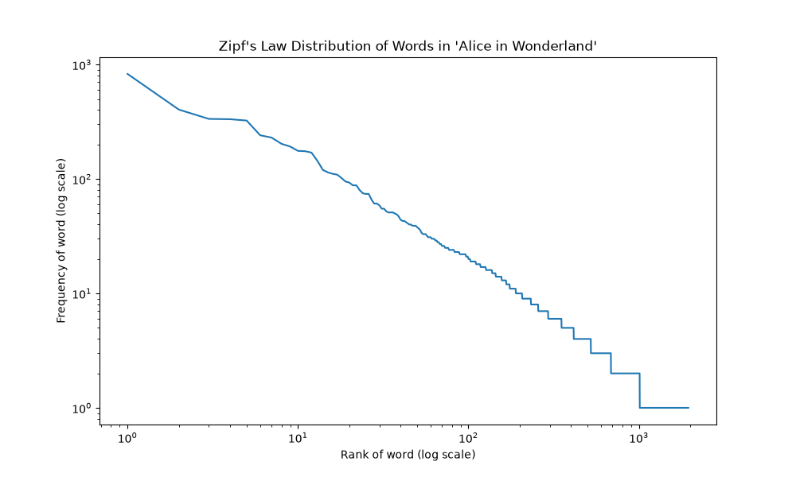

---
output:
  xaringan::moon_reader:
    seal: false
    includes:
      after_body: [insert-logo.html, slide-numbers.html]
    self_contained: false
    lib_dir: libs
    nature:
      highlightStyle: github
      highlightLines: true
      countIncrementalSlides: false
      ratio: '16:9'
editor_options:
  chunk_output_type: console
---
class: center, inverse, middle

```{r setup, include=FALSE}
knitr::opts_chunk$set(eval=TRUE, include=TRUE, cache=FALSE)
library(reticulate)
use_condaenv("sentiment2026")
```

```{r xaringan-panelset, echo=FALSE}
xaringanExtra::use_panelset()
```

```{r xaringan-tile-view, echo=FALSE}
xaringanExtra::use_tile_view()
```

```{r xaringanExtra, echo = FALSE}
xaringanExtra::use_progress_bar(color = "#808080", location = "top")
```

```{css echo=FALSE}
.pull-left {
  float: left;
  width: 44%;
}
.pull-right {
  float: right;
  width: 44%;
}
.pull-right ~ p {
  clear: both;
}


.pull-left-wide {
  float: left;
  width: 66%;
}
.pull-right-wide {
  float: right;
  width: 66%;
}
.pull-right-wide ~ p {
  clear: both;
}

.pull-left-narrow {
  float: left;
  width: 30%;
}
.pull-right-narrow {
  float: right;
  width: 30%;
}

.tiny123 {
  font-size: 0.40em;
}

.small123 {
  font-size: 0.80em;
}

.large123 {
  font-size: 2em;
}

.red {
  color: red
}

.orange {
  color: orange
}

.green {
  color: green
}

/* Reflection question, revealed at the end of a slide */
.reflect {
  position: absolute;
  bottom: 95px;
  left: 64px;
  width: 48%;
  padding: 0.3em 0 0.3em 0.6em;
  border-left: 4px solid #808080;
  background: rgba(255, 255, 255, 0.92);
}
.reflect-right {
  position: absolute;
  bottom: 95px;
  right: 64px;
  width: 40%;
  padding: 0.3em 0 0.3em 0.6em;
  border-left: 4px solid #808080;
  background: rgba(255, 255, 255, 0.92);
}

/* Painting slide: text box over a full-bleed image */
.overlay-box {
  background: rgba(0, 0, 0, 0.62);
  color: #fff;
  padding: 0.6em 1.1em;
  border-radius: 6px;
  display: inline-block;
}
.overlay-box h1, .overlay-box h2 {
  color: #fff;
  margin: 0.2em 0 0.3em 0;
}
.overlay-spoiler {
  margin-top: 0.8em;
}
.overlay-credit {
  position: absolute;
  bottom: 12px;
  left: 20px;
  font-size: 0.55em;
  color: #fff;
  background: rgba(0, 0, 0, 0.55);
  padding: 2px 8px;
  border-radius: 4px;
}
```


# News and Market Sentiment Analytics
## Lecture 2: Classical data wrangling with text

### Christian Vedel,<br>Department of Economics, University of Southern Denmark

### Email: [christian-vs@sam.sdu.dk](mailto:christian-vs@sam.sdu.dk)

### Updated `r Sys.Date()`


.footnote[
.left[
.small123[
*Please beware. I work on these slides until the last minute before the lecture and push most changes along the way. Until the actual lecture, this is just a draft*
]
]
]

---
class: middle
# Today's lecture
.pull-left-wide[
**Getting text into shape: The classical toolbox. Not glamorous, but you will come back to it**

- **Cleaning strings:** `str`, lowercasing, punctuation, numbers, Unicode
- **spaCy:** Tokens, lemmas, stopwords, part-of-speech tags
- **Lexical resources:** Word-list sentiment with AFINN
- **Cleaning for LLMs:** Why less is more
- **Coding challenge:** The Zipf mystery
]

.pull-right-narrow[

]

---
class: middle
# Last time
.pull-left-wide[
- Course overview: Content, free tools, AI, exam
- The Efficient Market Hypothesis and how NLP tools might still be useful
- How did we get to ChatGPT? (And what are the implications)
- Do language models have a world model?
- Coding challenge 1: Follow-up
]

.pull-right-narrow[

]

---
# A basic problem
.pull-left-wide[
Consider the headline

> "Novo Nordisk reported a modest increase in earnings, but analysts remain cautious."

- "the", "a" and "in" are **stopwords** that don't provide financial context
- "earnings" and "cautious" are the terms that matter for the stock
- Removing stopwords helps focus on the financially relevant content

Noise in $\rightarrow$ noise out<br>
Clean data in $\rightarrow$ clean results out
]

---
class: inverse, middle, center
# Cleaning strings

---
# The `str` object type
.pull-left-wide[
- The basic object type we will be working with

Let `a = "this_"` and `b = "string"`
- You can add strings together: `c = a + b` means that `print(c)` gives `"this_string"`
- You can pick out parts of a string: `print(a[1])` is `"h"`
- Test: `"this" in c` evaluates to `True`
]

---
# List comprehension
.pull-left-wide[
- A `list` can contain strings
- A **list comprehension** is a compact loop that builds a new list
- We will use it a lot in text processing
]

--

.pull-left[
### Loop
```{python loop-example}
input_strings = ["hello", "world"]
res = []
for x in input_strings:
  res.append(len(x))
```
]

.pull-right[
### List comprehension
```{python list-comprehension-example}
input_strings = ["hello", "world"]
res = [len(x) for x in input_strings]
```
]

---
# Lowercasing text
.pull-left-narrow[
- Consistency is key in text analysis
- Removes variation from capitalization ("Earnings" vs. "earnings")
]

--

.pull-right-wide[
```{python lowercase-example}
text = "Novo Nordisk reported a Modest INCREASE in Earnings."
cleaned_text = text.lower()
print(cleaned_text)
```
]

---
# Removing punctuation
.pull-left-narrow[
- Punctuation often adds little to the meaning of the words
- Helps focus on words rather than sentence structure
]

--

.pull-right-wide[
```{python punctuation-example}
import string

text = "Earnings were up 20%! However, caution remains high."
table = str.maketrans('', '', string.punctuation)
cleaned_text = text.translate(table)
print(cleaned_text)
```
]

---
# Normalizing whitespace
.pull-left-narrow[
- Sometimes we don't want spaces to carry meaning
- Sometimes we just want legible text
]

--

.pull-right-wide[
```{python whitespace-example}
text = "   Earnings report:   Novo shows increase. \n"

# Strip leading and trailing whitespace
cleaned_text = text.strip()

# Remove extra spaces between words
cleaned_text = " ".join(cleaned_text.split())
print(cleaned_text)
```
]

---
# Removing numbers
.pull-left-narrow[
- Focus on the language rather than the numbers
- Or maybe we are *only* interested in the numbers
- `re` is Python's **regular expression** library
]

--

.pull-right-wide[
```{python numbers-example}
import re

text = "The stock price increased by 20% in Q3 of 2021."
cleaned_text = re.sub(r'\d+', '', text)
print(cleaned_text)
```
]

---
# Handling special characters
.pull-left-narrow[
- Special characters (e.g. "$", "@") can add noise and break code
- Removing or replacing them simplifies the text
]

--

.pull-right-wide[
```{python special-characters-example}
text = "Check out our earnings on $AAPL and $GOOG!"

# Keep only letters and whitespace
cleaned_text = re.sub(r'[^A-Za-z\s]', '', text)
print(cleaned_text)
```
]

---
# Unicode normalization
.pull-left-narrow[
- The same character can be stored in more than one way: "é" as one code point, or as "e" + an accent
- They look identical, but `==` says they differ
- **Unicode normalization** (NFC, NFKC) picks one form. Nothing is lost
]

--

.pull-right-wide[
.small123[
```{python unicode-normalization-example}
from unicodedata import normalize
a, b = "café", "café"  # one character vs. 'e' + accent
print(a == b, len(a), len(b))
print(normalize("NFC", a) == normalize("NFC", b))
print(normalize("NFKC", "financial: ２０２６"))  # Look-alikes
```
]
]

---
# ASCII folding
.pull-left-narrow[
- `unidecode` goes further: It **transliterates** everything to plain ASCII
- Information is lost, but consistency is gained
- Useful for matching names across sources (more in Lecture 6)
]

--

.pull-right-wide[
```{python ascii-folding-example}
import unidecode

text = "Björk's café in Århus offers smørrebrød."
print(unidecode.unidecode(text))
```
]

---
# Tying it all together
.pull-left-narrow[
- String cleaning depends on the project
- Consistency matters, especially if we want to match on strings
- Define **one** function, `clean_strings()`, and use it everywhere in the project
]

--

.pull-right-wide[
```{python clean-strings-example}
def clean_strings(x):
  x = x.lower()
  x = x.translate(str.maketrans('', '', string.punctuation))
  x = unidecode.unidecode(x)
  x = " ".join(x.split())
  return x

text = "  Earnings report:  Novo up. \n Åse Aamund reacts ..."
print(clean_strings(text))
```
]

---
# .red[Practice 1: Clean by hand]
.pull-left-wide[
Run these headlines through `clean_strings()` **in your head**. Write down the output.

1. *"  Ørsted shares fall 12% after U.S. wind project is halted!  "*
2. *"$NVO up 3.2% pre-market — analysts: 'not a disaster'"*
3. *"Mærsk: NOT a good quarter."*

**Then:** Which information was lost? Which step would you skip for a sentiment model?

Check your answers by running the code.
]

.pull-right-narrow[
.small123[*Illustrative headlines, not real news*]
]

```{r practice1-answer, eval=FALSE, include=FALSE}
# TEACHER NOTES (outputs checked with the clean_strings() above)
# 1: "orsted shares fall 12 after us wind project is halted"
#    Lost: "%", "U.S." -> "us" (now the pronoun), the "!".
# 2: "nvo up 32 premarket -- analysts not a disaster"
#    Gotchas: "3.2%" -> "32" (a different number!); the em dash is not in
#    string.punctuation, so it survives and unidecode turns it into "--".
#    Order of steps matters: fold to ASCII first, then remove punctuation.
#    "$NVO" -> "nvo": the ticker marker is gone.
# 3: "maersk not a good quarter"
#    The emphasis in "NOT" is lost, but the word is kept.
# For sentiment: skip lowercasing (NOT, US) and number/punctuation removal.
```

---
class: inverse, middle, center
# spaCy

---
# The `spaCy` library
.pull-left-narrow[
- **spaCy** is an open-source, fast NLP library for Python
- Pre-trained pipelines: tokens, lemmas, part-of-speech tags, named entities, ...
- *Many problems can be solved with spaCy alone*
]

--

.pull-right-wide[
```{python spacy-tokenize-example}
import spacy
nlp = spacy.load("en_core_web_sm")  # Small English pipeline

doc = nlp("The company's earnings rose in Q3 2021.")
print(" | ".join(token.text for token in doc))
```
]

---
# Lemmatization
.pull-left-narrow[
- **Lemmatization** reduces words to their base form ("increased" $\rightarrow$ "increase")
- Count words without inflection
- Especially useful for irregular words ("is" $\rightarrow$ "be")
]

--

.pull-right-wide[
```{python lemmatization-example}
doc = nlp("Earnings have increased and the earner is happy.")
print(" ".join(token.lemma_ for token in doc))
```
]

---
# Removing stopwords
.pull-left-narrow[
- **Stopwords** are frequent, uninformative words ("the", "is", ...)
- Still useful for meaning: Don't remove them in more advanced NLP
]

--

.pull-right-wide[
```{python stopwords-example}
doc = nlp("The company has shown an increase in earnings.")
print([token.text for token in doc if not token.is_stop])

print("not" in nlp.Defaults.stop_words)
```
]

---
# Part-of-speech (POS) tagging
.pull-left-narrow[
- **POS tagging** labels each token with its part of speech (noun, verb, adjective, ...)
- The grammatical role of a word helps in tasks like sentiment analysis and classification
]

--

.pull-right-wide[
```{python pos-example}
text = "The stock price increased significantly."
doc = nlp(text)
for token in doc: print(token.text, token.pos_)
```
]

---
# .red[Practice 2: Predict spaCy]
.pull-left-wide[
*"Novo Nordisk did not beat expectations, and shares fell."*

1. What are the lemmas of "did", "shares" and "fell"?
2. Which tokens does spaCy drop as stopwords?
3. Read what is left. What is the sentiment now?

Then run it and check.
]

```{r practice2-answer, eval=FALSE, include=FALSE}
# TEACHER NOTES (checked with en_core_web_sm 3.8)
# 1: did -> do, shares -> share, fell -> fall
# 2: stopwords dropped: did, not, and
#    Left: ['Novo', 'Nordisk', 'beat', 'expectations', ',', 'shares', 'fell', '.']
# 3: "Novo Nordisk beat expectations, shares fell": the negation is gone and
#    the headline now reads as good news. Stopword removal flips sentiment.
```

---
class: inverse, middle, center
# Lexical resources

---
class: middle
# Lexical resources
.pull-left-wide[
- Once the text is clean, we can use it in analysis
- One example here: Word-count based sentiment analysis
- Mostly a classroom exercise, but it has real use cases
- The concepts generalize to more complex settings
]

.pull-right-narrow[
.small123[
Finance has its own word lists, e.g. [Loughran & McDonald (2011)](https://doi.org/10.1111/j.1540-6261.2010.01625.x): "liability" and "tax" are not negative in a 10-K
]
]

---
# AFINN
.pull-left[
- A word list with scores from -5 to +5, made by Finn Årup Nielsen at DTU
- [github.com/fnielsen/afinn](https://github.com/fnielsen/afinn), paper: [Nielsen (2011)](https://arxiv.org/abs/1103.2903)
- We use the newest English list, AFINN-165

> "That would have been splendid. It would have been absolutely amazing. The best there ever was. But it was not."

- 'best': 3, 'amazing': 4, 'splendid': 3
]

.pull-right[

*https://github.com/fnielsen*
]

--

.reflect[
**Reflect:** The sentence scores +10. Would a transformer agree (Coding challenge 1)?
]

---
# A very simple sentiment analysis
.pull-left-wide[
- What if we just count positive and negative words?

**Advantages**
- You can explain it to anyone
- Works surprisingly well

**Disadvantages**
- Cannot understand context
  + "Bull" is positive in finance
  + "Bull" is neutral or negative in everyday conversation
- Typos and spelling mistakes are not handled
]

---
class: middle
# Simple(st) sentiment analysis
*I will demonstrate a simple sentiment analysis in Python*

[Lecture 2 - Data wrangling with text/Code/Simple_sentiment.py](https://github.com/christianvedels/News_and_Market_Sentiment_Analytics/blob/main/Lecture%202%20-%20Data%20wrangling%20with%20text/Code/Simple_sentiment.py)

---
class: inverse, middle, center
# Cleaning for LLMs

---
# Should you clean text for an LLM?
.pull-left-wide[
- Today's cleaning steps shrink the vocabulary. That helps **word counts and word lists**
- Transformers bring their own **tokenizer**, trained on raw text (Lecture 4)
  + Case, punctuation and stopwords carry meaning: "US", "!", "not"
  + Heavy cleaning moves your text *away* from what the model saw in training
]

--

.pull-left-wide[
**Rule of thumb for LLMs:** Clean lightly
- Fix encoding and Unicode, normalize whitespace
- Remove boilerplate (HTML, banners) and duplicates
- Keep case, punctuation, numbers and stopwords
]

---
class: middle
# The Zipf mystery
*We will use basic NLP tools to investigate Zipf's law in the Gutenberg Corpus*

[Lecture 2 - Data wrangling with text/Code/Zipf.py](https://github.com/christianvedels/News_and_Market_Sentiment_Analytics/blob/main/Lecture%202%20-%20Data%20wrangling%20with%20text/Code/Zipf.py)

**Zipf's law:**

$$F_n = \frac{F_1}{n}$$

---
# Words are not random
.pull-left[
- *Alice in Wonderland:* "the" appears 828 times. Zipf predicts 828/2 = 414 for the second word. "and" appears 404 times
- The 10 most common words are **25%** of the text. Half of all distinct words appear only **once**
- Nobody designed this. It holds in every language

**Patterns like this can be used:**
- **Stopword lists** are the head of the curve
- **Tokenizers** (Lecture 4) split the rare words in the long tail
- Text that breaks the pattern is suspicious: OCR errors or synthetic text (today's coding challenge)
]

.pull-right[

.small123[*Word frequency against rank, log scales. Output of `Zipf.py`*]
]

---
class: inverse, middle
# Coding challenge:
## [The Zipf Mystery](https://github.com/christianvedels/News_and_Market_Sentiment_Analytics/blob/main/Lecture%202%20-%20Data%20wrangling%20with%20text/Coding_challenge_lecture2.md)

---
# Before next time
.pull-left[
- Solve the [coding challenge](https://github.com/christianvedels/News_and_Market_Sentiment_Analytics/blob/main/Lecture%202%20-%20Data%20wrangling%20with%20text/Coding_challenge_lecture2.md)

- Read Ch. 2 of Patel & Arasanipalai (2021)

- Read [the OccCANINE paper](https://arxiv.org/abs/2402.13604)

- Next time: Classification, with *OccCANINE* as a research example
]


.pull-right[

]
