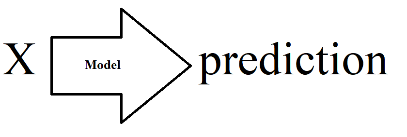
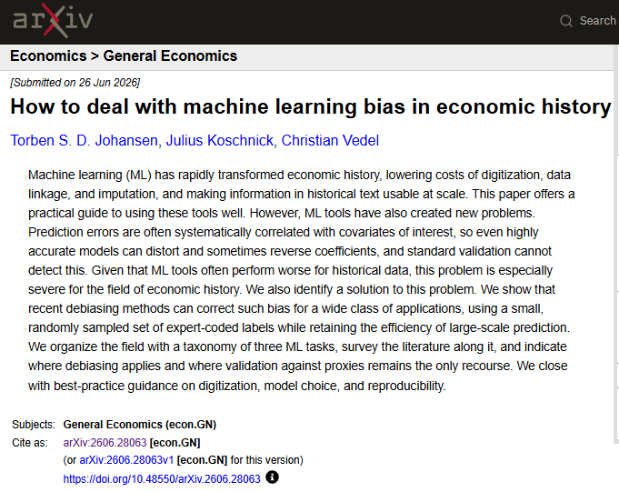
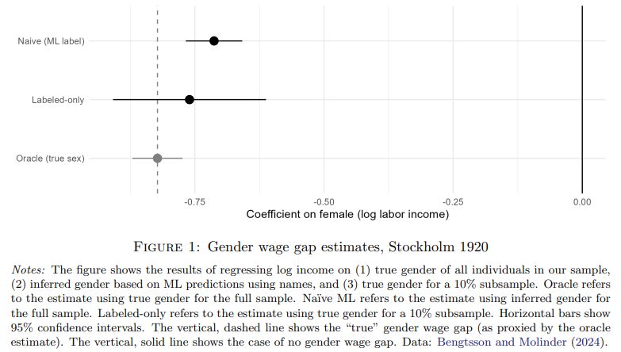

```{r setup, include=FALSE}
knitr::opts_chunk$set(eval=TRUE, include=TRUE, cache=FALSE)
library(reticulate)
use_condaenv("sentiment2026")
xaringanExtra::use_panelset()
```

```{python quiet-transformers, include=FALSE}
# Keep library warnings and load reports off the slides
import warnings
warnings.filterwarnings("ignore")
from transformers.utils import logging
logging.set_verbosity_error()
logging.disable_progress_bar()
```


```{css echo=FALSE}
.pull-left {
  float: left;
  width: 44%;
}
.pull-right {
  float: right;
  width: 44%;
}
.pull-right ~ p {
  clear: both;
}


.pull-left-wide {
  float: left;
  width: 66%;
}
.pull-right-wide {
  float: right;
  width: 66%;
}
.pull-right-wide ~ p {
  clear: both;
}

.pull-left-narrow {
  float: left;
  width: 30%;
}
.pull-right-narrow {
  float: right;
  width: 30%;
}

.small123 {
  font-size: 0.80em;
}

.large123 {
  font-size: 2em;
}

.red {
  color: red
}
```

# Last time
.pull-left[
- Cleaning strings: lowercasing, punctuation, Unicode normalization, ASCII folding
- spaCy: lemmas, stopwords, part of speech
- Lexical resources (AFINN) and a first sentiment score
- Zipf's law, and the Zipf mystery coding challenge
]

.pull-right-narrow[

]

---
# Today's lecture
.pull-left[
- Simple text classification
- SoTA text classification in news and market sentiment analytics
- Off-the-shelf models
- Transfer learning
]

.pull-right-narrow[

]

---
class: middle
# Features to extract 
.pull-left[
- Word endings 
- Sentiment 
- Word type 
- Count vectorizer 
- Transformers:
  + Zero-shot classification (later today)
  + Sentiments
  + Embeddings
- ...All the relevant things we will learn about in the course 
]

.pull-right[

]


---
# The Naïve Bayes classifier (1/2)
.pull-left-wide[
.small123[
- We can infer $P(Class|X)$ via $P(X|Class)$
- In the Naïve Bayes classifier, we assume features are conditionally independent given the class, simplifying the calculation: $P(X|Class) = P(x_1|Class) \cdot P(x_2|Class) \cdot \ldots$
- Simple and very widely used classifier 
- $X$ is the features 
  + $P(Class|x_i) = P(x_i|Class)P(Class)/P(x_i)$ (Bayes' law)
  + $P(x_i|Class)=\frac{1}{n}\sum_{j\in Class} 1[x_j]$
  + $P(Class)$ can be assumed or estimated; $P(x_i)$ can also be estimated
  
- Assumes independence between features

- We will walk over intuition in the following slides
]
]


.pull-right-narrow[

.small123[*Maybe* Bayes, wikimedia commons]
]
  

.footnote[
.small[
1. [See 3Blue1Brown's explanation of Bayes' theorem](https://youtu.be/U_85TaXbeIo)
2. You can use libraries for this, but often it makes more sense to implement it manually
]
]


---
# The Naïve Bayes classifier (2/2)

.small123[
- This and similar approaches used extensively for feature extraction and in social science research
  + The maths is simple and clear, which helps in Causal Inference applications 
  + We want to know the *kinds of errors* more rather than *minimizing the errors*
  + Sometimes works really well
- Two examples: 
  + [Andersen & Bentzen (2022)](https://ideas.repec.org/p/cpr/ceprdp/16938.html): More religious names are associated with less technological development
  + [Bentzen, Boberg-Fazlic, Sharp, Skovsgaard, Vedel (2024)](https://ideas.repec.org/p/hes/wpaper/0253.html): Certain Danish religious movements are associated with less integration into the US in the 1800s. But this seemingly has little consequence for occupational outcomes.
  
- Always start with NB when dealing with textual data
- But do use other models as well :-)
]

---
class: middle
# NB intuition: Genders from names (1/5)

.pull-left-wide[
- We want to classify a name as either *male* or *female* 
- **Training data:** A list of of female / male names
- **Goal:** Use this data to produce a classifier
- **Note:** We do not need any fancy neural nets. We just need basic probability theory. 
]

---
class: middle
# NB intuition: Genders from names (2/5)
- Say we observe 20000 names - 10000 for each gender
- **What we observe:** The frequency of names among genders
  + "Carl" might appear 1023/10000 times as male and 3/10000 times as female in our data
  + "Carla" might appear 5/10000 times as male and 2148/10000 times as female in our data
  + Etc.
  
- **We can derive** an estimate of $Pr(Gender | Name)$:
  + $Pr(Name = \text{"Carl"} | Gender = \text{"Male"}) \approx 1023 / 10000 = 0.1023$
  + $Pr(Name = \text{"Carl"} | Gender = \text{"Female"}) \approx 3 / 10000 = 0.0003$
  + $Pr(Name = \text{"Carla"} | Gender = \text{"Male"}) \approx 5 / 10000 = 0.0005$
  + $Pr(Name = \text{"Carla"} | Gender = \text{"Female"}) \approx 2148 / 10000 = 0.2148$ 
  + *Repeat for all names and classes* 
- This is the "training" procedure for NB
  

---
class: middle
# NB intuition: Genders from names (3/5)

.pull-left-wide[
- **What we have:** An estimate of $Pr(Name | Gender)$
- **What we want:** An estimate of $Pr(Gender | Name)$

- **Solution:** Bayes' law: $Pr(Gender | Name) = \frac{Pr(Name | Gender) Pr(Gender)}{Pr(Name)}$
]

---
# NB intuition: Genders from names (4/5)

*We will calculate the probability that "Carla" is female*

--
#### 1. Assume $Pr(Gender = \text{"Female"}) = 0.5$ (Is this reasonable?)

--
#### 2. Calculate $Pr(Name = \text{"Carla"})$

--

$$Pr(Name) = \sum_{Gender} Pr(Name | Gender) Pr(Gender)$$

--

$$Pr(Name = \text{"Carla"}) = Pr(\text{"Carla"} | \text{"Female"}) Pr(\text{"Female"}) + Pr(\text{"Carla"} | \text{"Male"}) Pr(\text{"Male"})$$

--

$$Pr(Name = \text{"Carla"}) = 0.2148 \times 0.5 + 0.0005 \times 0.5$$

--

$$Pr(Name = \text{"Carla"}) = 0.10765$$

--
#### 3. Retrieve $Pr(Name = \text{"Carla"} | Gender = \text{"Female"}) = 0.2148$ from "training"


---
# NB intuition: Genders from names (5/5)

--
#### 4. Putting it all together

--

$$Pr(Gender = \text{"Female"} | Name = \text{"Carla"}) = \frac{Pr(\text{"Carla"} | \text{"Female"}) Pr(\text{"Female"})}{Pr(\text{"Carla"})}$$

--

$$Pr(Gender = \text{"Female"} | Name = \text{"Carla"}) = \frac{0.2148 \times 0.5}{0.10765}$$

--

$$Pr(Gender = \text{"Female"} | Name = \text{"Carla"}) = \frac{0.10740}{0.10765}$$


--
### Result:

$$Pr(Gender = \text{"Female"} | Name = \text{"Carla"}) = 0.998$$


*Note: Simple to automate and **fast** to compute*

---
# A real application 
.pull-left-wide[
- Census data can be the source of knowledge about long run development
- Census data does not always contain genders 
- We can use the gender information in names 
- Used via a Naive-Bayes classifier 
- This time using the entire name

- **Turns out:** We can obtain 98.1% accuracy with Naïve-Bayes
]

.pull-right-narrow[

*Census data, 1840, wikimedia*
]


---
# Simple Naïve Bayes to identify gender
[Lecture 3 - Classification/Code/Gender_classification_all_Danish_names.py](https://github.com/christianvedels/News_and_Market_Sentiment_Analytics/blob/main/Lecture%203%20-%20Classification/Code/Gender_classification_all_Danish_names.py)

- Using modern name/gender data to build a classifier that works in 1787

---
# Feature extraction 

### 1. Word type
```{python}
import spacy

# Load the spaCy model
nlp = spacy.load("en_core_web_sm")

# Function to extract word type as a feature
def word_type_feature(word):
    doc = nlp(word)
    pos_tag = doc[0].pos_
    return {"word_type": pos_tag}

# Example usage
print(word_type_feature("dog"))

```

---
# Feature extraction 

### 2. Count vectorizer
```{python}
import spacy
from collections import Counter

# Load the spaCy model
nlp = spacy.load("en_core_web_sm")

# Function to extract token counts as features
def count_vectorizer_feature(corpus):
    doc = nlp(" ".join(corpus))
    word_counts = Counter([token.text.lower() for token in doc if token.is_alpha])
    return dict(word_counts)

# Example usage
corpus = ["This is the first document.", "This document is the second document."]
print(count_vectorizer_feature(corpus))
```

---
# Feature extraction
### 3. Simple bag of words sentiment
```{python}
# ... code from last time
```

---
# Feature extraction
### 4. Length of the Text
```{python}
# Function to extract text length as a feature
def text_length_feature(text):
    return {"text_length": len(text)}

# Example usage
print(text_length_feature("This is a short text."))

```

---
# Feature extraction
### 5: Number of Words
```{python}
import spacy

# Load the spaCy model
nlp = spacy.load("en_core_web_sm")

# Function to extract number of words as a feature
def word_count_feature(text):
    doc = nlp(text)
    return {"word_count": len([token for token in doc if token.is_alpha])}

# Example usage
print(word_count_feature("This is an example sentence."))

```

---
# Feature extraction
### 6: Average Word Length
```{python}
import spacy

# Load the spaCy model
nlp = spacy.load("en_core_web_sm")

# Function to extract average word length as a feature
def avg_word_length_feature(text):
    doc = nlp(text)
    words = [token for token in doc if token.is_alpha]
    avg_length = sum(len(word) for word in words) / len(words) if words else 0
    return {"avg_word_length": avg_length}

# Example usage
print(avg_word_length_feature("This is a demonstration of average word length."))

```

---
# Feature extraction
### 7: Presence of Specific Words
```{python}
import spacy

# Load the spaCy model
nlp = spacy.load("en_core_web_sm")

# Function to check the presence of specific words as features
def specific_word_feature(text, target_words):
    doc = nlp(text)
    features = {}
    for word in target_words:
        features[f"contains_{word}"] = any(token.text.lower() == word for token in doc)
    return features

# Example usage
text = "This is a sample text with some specific words."
target_words = ["sample", "specific"]
print(specific_word_feature(text, target_words))

```

---
# Feature extraction
### 8: Zipf's law features
```{python}
# ... Zipf coefficient from coding challenge 2
```


---
# Feature extraction 
### 9. ZeroShot Classification with Transformers
```{python}
from transformers import pipeline

# Function for zero-shot classification
def zero_shot_classification(text, labels):
    classifier = pipeline("zero-shot-classification", model = "facebook/bart-large-mnli")
    result = classifier(text, labels)
    return {label: score for label, score in zip(result["labels"], result["scores"])}

# Example usage
text = "The movie was captivating and full of suspense."
labels = ["exciting", "dull", "intellectual"]
print(zero_shot_classification(text, labels))
```

---
# A cautionary sidenote: Accuracy is not everything

.small123[[Johansen, Koschnick & Vedel (2026), *How to deal with machine learning bias in economic history*](https://arxiv.org/abs/2606.28063)]

.panelset[
.panel[.panel-name[The problem]
.center[]
]

.panel[.panel-name[Example: The gender wage gap]
.center[]

Gender predicted from names (as in the Naïve Bayes example) gives a smaller gender wage gap than the true gender does
]
]

---
class: inverse, middle
## [Breaking the HISCO Barrier: Automatic Occupational Standardization with OccCANINE*](https://christianvedels.github.io/Presentations/HISCO%20Slides/Slides.html#1)
### *Conference presentation: An example of the kind of research I do with things you learn about in this course*

.footnote[
\* *it's a link that you can click!* The paper: [arXiv 2402.13604](https://arxiv.org/abs/2402.13604)
.small123[
[More details](https://christianvedels.github.io/Presentations/HISCO/Slides.html)
]
]


---
class: inverse, middle, center

# More advanced classification

---
class: middle
<div style="display: flex; align-items: center;">
    
    <h1 style="margin: 0;">HuggingFace</h1>
</div>

.pull-left[
- HuggingFace is a platform for sharing machine learning models
- Most of the most advanced pretrained models are available here
- You can use the *off the shelf* or finetune them. Plenty of guidance available
]


---
class: middle

.pull-left-wide[
### Exercise
- Try navigating to [HuggingFace.co](https://huggingface.co/)
- Look for a model for one of the following tasks: Image Classification, Text Classification, Zero-Shot Classification, Translation, Sentence Similarity
- Take a picture of yourself (or some on the internet) and try this tool: [huggingface.co/spaces/schibsted-presplit/facial_expression_classifier](https://huggingface.co/spaces/schibsted-presplit/facial_expression_classifier)
]


---
class: middle

## `pipeline`
- You can interact with many of these models using the `pipeline` interface of the `transformers` library
- You make an *instance* of a model by calling `pipeline(task = "...")`
- You can find an overview of tasks here: [huggingface.co/docs/transformers/main/en/quicktour#pipeline](https://huggingface.co/docs/transformers/main/en/quicktour#pipeline)

---
class: middle

# Demo 1: Pictures from the news

.pull-left-wide[
- Automatic image description
]

.pull-right-narrow[

.small123[
Jensen Huang (CEO, NVIDIA) [picture from wikimedia](https://upload.wikimedia.org/wikipedia/commons/3/36/Jensen_Huang_20231109_%28cropped2%29.jpg)
]
]

---
class: middle

# Demo 1: Auto caption

.pull-left-wide[
.small123[
```{python, messages=FALSE}
from PIL import Image
from transformers import BlipProcessor
from transformers import BlipForConditionalGeneration as Blip

name = "Salesforce/blip-image-captioning-base"
processor = BlipProcessor.from_pretrained(name)
model = Blip.from_pretrained(name)

path = "Figures/Jensen_Huang_20231109.jpg"
image = Image.open(path).convert("RGB")
inputs = processor(images=image, return_tensors="pt")
out = model.generate(**inputs, max_new_tokens=30)
```
]

```{python}
print(processor.decode(out[0], skip_special_tokens=True))
```
]

.pull-right-narrow[

.small123[
Jensen Huang (CEO, NVIDIA) [picture from wikimedia](https://upload.wikimedia.org/wikipedia/commons/3/36/Jensen_Huang_20231109_%28cropped2%29.jpg)
]
]

---
class: middle
# Demo 2: Sentiment analysis

```{python, messages=FALSE}
from transformers import pipeline
classifier = pipeline(
    task = "sentiment-analysis", 
    model = "distilbert/distilbert-base-uncased-finetuned-sst-2-english"
)
result = classifier("It is a lot of fun to learn advanced ML stuff.")
```

```{python}
print(result)
```

---
class: middle
# Demo 3: Named Entity Recognition

```{python}
from transformers import pipeline
model = pipeline(task = "ner", model = "dslim/bert-base-NER")
result = model(
    """
    Mr. Edward Jameson, born on October 15, 1867, in Concord, Massachusetts, 
    is a gentleman of notable accomplishments. He received his early 
    education at the local academy and graduated with honors from Harvard 
    College in 1888. Pursuing a career in law, he quickly rose to prominence 
    through his sagacity and dedication."
    """
)
```

```{python}
print(result)
```

---
class: middle
# Demo 4: Text generation from LLM

```{python, eval=FALSE}
from transformers import pipeline
import torch

model = pipeline(
    task = "text-generation", 
    model = 'HuggingFaceH4/zephyr-7b-beta', 
    torch_dtype=torch.bfloat16, 
    device_map='auto',
    )
result = model(
    "The practical aspects of data science", 
    max_length=50, 
    truncation=True,
    )
```

```{python, eval=FALSE}
print(result)
```

---
class: middle
# Demo 5: Zero-shot classification

**Example from last time**
```{python}
from transformers import pipeline

# Function for zero-shot classification
def zero_shot_classification(text, labels):
    classifier = pipeline("zero-shot-classification", model = "facebook/bart-large-mnli")
    result = classifier(text, labels)
    return {label: score for label, score in zip(result["labels"], result["scores"])}

# Example usage
text = "The movie was captivating and full of suspense."
labels = ["exciting", "dull", "intellectual"]
print(zero_shot_classification(text, labels))
```

---
class: middle

# Two approaches
.pull-left[
## Off-the-shelf
- *We can use models directly from e.g. HuggingFace*

#### Advantages
- Fast
- Often works well

#### Drawback
- Performance loss
- Poor performance in niche tasks
]

.pull-right[
## Transfer learning
- *We can adapt models to our needs*

#### Advantages
- Still relatively fast
- Can work surprisingly well

#### Drawback
- More code, more problems
- More fudging needed to get a solution to work
- Training can be expensive (time/server/etc)
]

---
# Transfer learning

- The idea
- The transformer solution to finetuning
- Building a PyTorch model with BERT inside
- To freeze or not to freeze? 

---
class: middle

# The Transformer Solution to Fine-tuning

.pull-left[
- Transformers are particularly well-suited for transfer learning
- Models like BERT, GPT, and T5 are pre-trained on large text corpora and can be fine-tuned for specific tasks
- Fine-tuning usually involves:
  + Modifying the model’s output layers
  + Training on your domain-specific data

]

---
# Building a PyTorch Model with BERT Inside

.pull-left[

1. **Load Pre-trained BERT Model**:
   - We use `transformers` to load a pre-trained model like BERT.
   
2. **Modify Output Layer**:
   - The output layer is adjusted for specific tasks (e.g., classification, named entity recognition).

3. **Fine-tuning**:
   - We fine-tune the model on our labeled data.
   
4. **Training Loop**:
   - Set up a PyTorch training loop for optimization.
]


```{python, eval=FALSE}
from transformers import BertForSequenceClassification, BertTokenizer
import torch
from torch.utils.data import DataLoader

# Load pre-trained BERT
model = BertForSequenceClassification.from_pretrained("bert-base-uncased", num_labels=2)

# Tokenizer
tokenizer = BertTokenizer.from_pretrained("bert-base-uncased")

# Example input text
text = "HuggingFace is an incredible resource for NLP."

# Tokenize input
inputs = tokenizer(text, return_tensors="pt")

# Forward pass
outputs = model(**inputs)
```


---
# The 'manual' way in `PyTorch`

.small123[
```{python, eval=FALSE}
import torch
import torch.nn as nn
from transformers import BertModel, BertConfig

class BERTClassifier(nn.Module):
    # Constructor class
    def __init__(self, config):
        super().__init__()
        
        # Load pre-trained BERT model
        self.basemodel = BertModel.from_pretrained(config["model_name"])
        
        # Dropout layer for regularization
        self.drop = nn.Dropout(p=config["dropout_rate"])
        
        # Output layer
        self.out = nn.Linear(self.basemodel.config.hidden_size, config["n_classes"])

    # CONTINUED ON NEXT PAGE ...
```
]


---
class: middle

.small123[
```{python, eval=FALSE}
    # Forward propagation method
    def forward(self, input_ids, attention_mask):
        # Pass input through BERT model
        outputs = self.basemodel(
            input_ids=input_ids,
            attention_mask=attention_mask
        )
        
        # Take the pooled output from the last layer of BERT
        pooled_output = outputs.pooler_output
        
        # Apply dropout
        output = self.drop(pooled_output)

        # Pass through the output layer to get logits
        return self.out(output)
```

]


---
class: middle

# To Freeze or Not to Freeze?

.pull-left[
### Freezing Layers:
- Freezing layers means not updating the weights during training.
- Can speed up training by reducing the number of parameters to optimize.
- Helps prevent overfitting, especially on small datasets.

### Unfreezing Layers:
- Unfreezing some or all layers allows the model to adjust more, improving performance for specific tasks.
- Typically results in better performance when enough labeled data is available.
]

.pull-right[
### Best Practice:
- Fine-tune the last few layers first to adapt the model to the new task.
- Gradually unfreeze more layers if necessary, allowing the model to learn more complex features.
]

---
# Freezing and unfreezing
```{python, eval=FALSE}
# First, freeze all layers
for param in model.basemodel.parameters():
    param.requires_grad = False
```

```{python, eval=FALSE}
# Gradually unfreeze layers in stages (e.g., unfreeze the last n layers)
def unfreeze_layers(model, num_layers_to_unfreeze=1):
    # Unfreeze the last `num_layers_to_unfreeze` layers of BERT
    total_layers = len(model.basemodel.encoder.layer)
    
    # Unfreeze from the last layer to the specified number of layers
    for i in range(total_layers - num_layers_to_unfreeze, total_layers):
        for param in model.basemodel.encoder.layer[i].parameters():
            param.requires_grad = True
```

```{python, eval=FALSE}
# Example: Unfreeze the last 2 layers
unfreeze_layers(model, num_layers_to_unfreeze=2)
```


---
class: inverse, middle
# Coding challenge: 
## [Building a sentiment classifier](https://github.com/christianvedels/News_and_Market_Sentiment_Analytics/blob/main/Lecture%203%20-%20Classification/Coding_challenge_lecture3.md)

---
# Next time
.pull-left[
- Nuts and bolts: Tokenization and embeddings
- Reading: PA2021 Ch. 4 and 5, and [3Blue1Brown: Attention in transformers, visually explained](https://youtu.be/eMlx5fFNoYc?si=HtfNuNlO4Y0e3olH)

**Exam:** Take-home exam 13–20 Dec; full details in Lecture 7
]

.pull-right[

]


