```{r setup, include=FALSE}
knitr::opts_chunk$set(eval=TRUE, include=TRUE, cache=FALSE)
library(reticulate)
use_condaenv("sentiment2026")
```

```{r xaringan-panelset, echo=FALSE}
xaringanExtra::use_panelset()
```

```{python include=FALSE}
def print_it(x):
  for i in x: print(i)
```


```{css echo=FALSE}
.pull-left {
  float: left;
  width: 44%;
}
.pull-right {
  float: right;
  width: 44%;
}
.pull-right ~ p {
  clear: both;
}


.pull-left-wide {
  float: left;
  width: 66%;
}
.pull-right-wide {
  float: right;
  width: 66%;
}
.pull-right-wide ~ p {
  clear: both;
}

.pull-left-narrow {
  float: left;
  width: 30%;
}
.pull-right-narrow {
  float: right;
  width: 30%;
}

.small123 {
  font-size: 0.80em;
}

.large123 {
  font-size: 2em;
}

.red {
  color: red
}
```

# Last time
.pull-left[
- SoTA text classification in news and market sentiments analytics
- Off-the shelf models
- Transfer learning
]

.pull-right-narrow[

]

---
class: middle
# Today's lecture
.pull-left[
- Tokenization
- Embedding space
- The nuts and bolts of modern NLP
]

.pull-right-narrow[

]


---
class: middle
# Tokenization

.pull-left[
- The problem: Text is not numbers

]

.pull-right[
### Example
- "what is this sentence?"

Some options:
  - Characters level tokenizaiton `[ord(char) for char in text]`: `[119, 104, 97, 116, 32, 105, 115, ...]` 
  - Word-level tokenization `["what", "is", "this", "sentence", "?"]`: `[5, 3, 2, 4, 99]`
  - Subword-level tokenization `["what", "is", "this", "sen", "##tence", "?"]`: `[5, 3, 4, 7, 1, 11]`
]

---
class: middle
# .red[Practice 1: Tokenize a headline]

.pull-left-wide[
**"Novo Nordisk's Wegovy sales beat expectations"**

1. How many tokens does a character-level tokenizer give? And a word-level tokenizer?
2. A word-level vocabulary built from news up to 2015 has never seen "Wegovy" (approved in 2021). What happens to it? How does subword tokenization help?
3. Why could tickers such as "NVO" or "$TSLA" cause problems for a tokenizer?
]

```{r practice1_answers, eval=FALSE, include=FALSE}
# 1. Characters: 45 (including spaces). Words: 6 split on spaces,
#    7 if "'s" is split off (spaCy: Novo, Nordisk, 's, Wegovy, sales, beat, expectations)
# 2. It becomes an unknown token ([UNK]): all information about the drug is lost.
#    Subwords split it into known pieces (e.g. "We", "##go", "##vy"), so it still gets a
#    representation and the model can learn it from context.
# 3. Rare in training text, ambiguous (NVO vs a word), symbols like "$" are split off,
#    and case matters. Tickers are often cut into meaningless pieces.
```

---
class: middle
# Tokenization in practice

```{python}
import spacy
nlp = spacy.load("en_core_web_sm") # Small Eng. model
```

```{python}

print_it(nlp.pipeline) # Contains the basic pipeline
```

---
class: middle
# Working with very large data

```{python}
# The pipeline can be heavy for very large data
# We can disable things we don't need
nlp = spacy.load("en_core_web_sm", disable=["parser","ner"])
```

```{python}
# GPU can also help speeding up things
if spacy.prefer_gpu():
  print("Working on GPU")
else:
  print("No GPU found, working on CPU")
```

---
class: middle
# Tangent: Nanmed Entity Recognition (NER)
.pull-left[
*Fisher Asset Management LLC lessened its holdings in Novo Nordisk A/S (NYSE:NVO - Free Report) by 0.5% during the third quarter, according to the company in its most recent Form 13F filing with the Securities & Exchange Commission. The institutional investor owned 13,305,474 shares of the company's stock after selling 65,153 shares during the quarter. Fisher Asset Management LLC owned 0.30% of Novo Nordisk A/S worth $1,584,283,000 as of its most recent SEC filing.*

```{python, eval=FALSE}
text = """
    Fisher Asset Management LLC lessened its holdings in Novo Nordisk A/S (NYSE:NVO - Free Report) by 0.5% during the third quarter, according to the company in its most recent Form 13F filing with the Securities & Exchange Commission. The institutional investor owned 13,305,474 shares of the company's stock after selling 65,153 shares during the quarter. Fisher Asset Management LLC owned 0.30% of Novo Nordisk A/S worth $1,584,283,000 as of its most recent SEC filing.
  """
# Source: https://www.marketbeat.com/instant-alerts/fisher-asset-management-llc-sells-65153-shares-of-novo-nordisk-as-nysenvo-2024-11-25/
import spacy
nlp = spacy.load("en_core_web_sm")
doc = nlp(text)
spacy.displacy.render(doc, style ='ent')
```
]

--

.pull-right[
.small123[
<div class="entities" style="line-height: 2.5; direction: ltr"></br>    <mark class="entity" style="background: #7aecec; padding: 0.45em 0.6em; margin: 0 0.25em; line-height: 1; border-radius: 0.35em;">    Fisher Asset Management    <span style="font-size: 0.8em; font-weight: bold; line-height: 1; border-radius: 0.35em; vertical-align: middle; margin-left: 0.5rem">ORG</span></mark> LLC lessened its holdings in <mark class="entity" style="background: #7aecec; padding: 0.45em 0.6em; margin: 0 0.25em; line-height: 1; border-radius: 0.35em;">    Novo Nordisk A/S    <span style="font-size: 0.8em; font-weight: bold; line-height: 1; border-radius: 0.35em; vertical-align: middle; margin-left: 0.5rem">ORG</span></mark> (<mark class="entity" style="background: #7aecec; padding: 0.45em 0.6em; margin: 0 0.25em; line-height: 1; border-radius: 0.35em;">    NYSE    <span style="font-size: 0.8em; font-weight: bold; line-height: 1; border-radius: 0.35em; vertical-align: middle; margin-left: 0.5rem">ORG</span></mark>:<mark class="entity" style="background: #7aecec; padding: 0.45em 0.6em; margin: 0 0.25em; line-height: 1; border-radius: 0.35em;">    NVO - Free Report    <span style="font-size: 0.8em; font-weight: bold; line-height: 1; border-radius: 0.35em; vertical-align: middle; margin-left: 0.5rem">ORG</span></mark>) by <mark class="entity" style="background: #e4e7d2; padding: 0.45em 0.6em; margin: 0 0.25em; line-height: 1; border-radius: 0.35em;">    0.5%    <span style="font-size: 0.8em; font-weight: bold; line-height: 1; border-radius: 0.35em; vertical-align: middle; margin-left: 0.5rem">PERCENT</span></mark> during <mark class="entity" style="background: #bfe1d9; padding: 0.45em 0.6em; margin: 0 0.25em; line-height: 1; border-radius: 0.35em;">    the third quarter    <span style="font-size: 0.8em; font-weight: bold; line-height: 1; border-radius: 0.35em; vertical-align: middle; margin-left: 0.5rem">DATE</span></mark>, according to the company in its most recent <mark class="entity" style="background: #aa9cfc; padding: 0.45em 0.6em; margin: 0 0.25em; line-height: 1; border-radius: 0.35em;">    Form 13F    <span style="font-size: 0.8em; font-weight: bold; line-height: 1; border-radius: 0.35em; vertical-align: middle; margin-left: 0.5rem">PERSON</span></mark> filing with <mark class="entity" style="background: #7aecec; padding: 0.45em 0.6em; margin: 0 0.25em; line-height: 1; border-radius: 0.35em;">    the Securities &amp; Exchange Commission    <span style="font-size: 0.8em; font-weight: bold; line-height: 1; border-radius: 0.35em; vertical-align: middle; margin-left: 0.5rem">ORG</span></mark>. The institutional investor owned <mark class="entity" style="background: #e4e7d2; padding: 0.45em 0.6em; margin: 0 0.25em; line-height: 1; border-radius: 0.35em;">    13,305,474    <span style="font-size: 0.8em; font-weight: bold; line-height: 1; border-radius: 0.35em; vertical-align: middle; margin-left: 0.5rem">CARDINAL</span></mark> shares of the company\'s stock after selling <mark class="entity" style="background: #e4e7d2; padding: 0.45em 0.6em; margin: 0 0.25em; line-height: 1; border-radius: 0.35em;">    65,153    <span style="font-size: 0.8em; font-weight: bold; line-height: 1; border-radius: 0.35em; vertical-align: middle; margin-left: 0.5rem">CARDINAL</span></mark> shares during <mark class="entity" style="background: #bfe1d9; padding: 0.45em 0.6em; margin: 0 0.25em; line-height: 1; border-radius: 0.35em;">    the quarter    <span style="font-size: 0.8em; font-weight: bold; line-height: 1; border-radius: 0.35em; vertical-align: middle; margin-left: 0.5rem">DATE</span></mark>. <mark class="entity" style="background: #7aecec; padding: 0.45em 0.6em; margin: 0 0.25em; line-height: 1; border-radius: 0.35em;">    Fisher Asset Management    <span style="font-size: 0.8em; font-weight: bold; line-height: 1; border-radius: 0.35em; vertical-align: middle; margin-left: 0.5rem">ORG</span></mark> <mark class="entity" style="background: #7aecec; padding: 0.45em 0.6em; margin: 0 0.25em; line-height: 1; border-radius: 0.35em;">    LLC    <span style="font-size: 0.8em; font-weight: bold; line-height: 1; border-radius: 0.35em; vertical-align: middle; margin-left: 0.5rem">ORG</span></mark> owned <mark class="entity" style="background: #e4e7d2; padding: 0.45em 0.6em; margin: 0 0.25em; line-height: 1; border-radius: 0.35em;">    0.30%    <span style="font-size: 0.8em; font-weight: bold; line-height: 1; border-radius: 0.35em; vertical-align: middle; margin-left: 0.5rem">PERCENT</span></mark> of <mark class="entity" style="background: #7aecec; padding: 0.45em 0.6em; margin: 0 0.25em; line-height: 1; border-radius: 0.35em;">    Novo Nordisk A/S    <span style="font-size: 0.8em; font-weight: bold; line-height: 1; border-radius: 0.35em; vertical-align: middle; margin-left: 0.5rem">ORG</span></mark> worth $<mark class="entity" style="background: #e4e7d2; padding: 0.45em 0.6em; margin: 0 0.25em; line-height: 1; border-radius: 0.35em;">    1,584,283,000    <span style="font-size: 0.8em; font-weight: bold; line-height: 1; border-radius: 0.35em; vertical-align: middle; margin-left: 0.5rem">MONEY</span></mark> as of its most recent <mark class="entity" style="background: #7aecec; padding: 0.45em 0.6em; margin: 0 0.25em; line-height: 1; border-radius: 0.35em;">    SEC    <span style="font-size: 0.8em; font-weight: bold; line-height: 1; border-radius: 0.35em; vertical-align: middle; margin-left: 0.5rem">ORG</span></mark> filing.</br>  </div>
]
]

---
# Embeddings
### One step back: What problem are we trying to solve?
--

### Original problem: Text similarity
Is text $x$ 'equal' to text $y$?
--

## Text similarity measures

- String distance* 
- Document Term Matrix Distance
- Embedding distance

.footnote[
$^*$ covered in more detail next time
]

---
class: middle
# Basic similarity measures
.pull-left-narrow[
- String distance (divergence*): Hamming, Levenstein, Jaro-Winkler
- More one these next time
- For now just an example on the right
]


.pull-right-wide[
.small123[
```{python spelling-correction}
from nltk.metrics import edit_distance

# Original text
text = "The cat sat on the met."

# Misspelled word
misspelled_word = "met"

# Candidate correct words
correct_words = ["mat", "mete", "meet", "meat"]

# Select the word with the minimum Levenshtein Distance as the correction
closest_word = min(correct_words, key=lambda word: edit_distance(misspelled_word, word))

print(f"Closest Correct Spelling: {closest_word}")

```
]
]

.footnote[
$^*$ formally speaking it is a divergence since it is not symmetrical.
]

---
class: middle
# Levensthein distance

.pull-left[
- Most common basic string distance measure 
- $O(mn)$ complexity - you can run it 
- Consists of edits: deletions, insertions, substitutions 
]


.pull-right[
**Levensthein distance**  
kitten $\rightarrow$ sitting
1. sitten (substitution of 's' for 'k')
2. sittin (substitution of 'i' for 'e')
3. sitting (insertion of 'g')
]

---
class: middle
# 10 problems with basic string similarity measures
```{r eval=FALSE, include=FALSE}
word_pairs = data.frame(
  word1 = c("Silent", "Wealthy", "Start", "Help", "Angry", "Happy", "Big", "Small", "Tired", "Friend"),
  word2 = c("Quiet", "Affluent", "Commence", "Assist", "Furious", "Joyful", "Enormous", "Tiny", "Exhausted", "Companion")
)
for(i in 1:NROW(word_pairs)){
  word_pairs$sim[i] = 1 - adist(word_pairs$word1[i], word_pairs$word2[i]) / max(nchar(word_pairs$word1[i]), nchar(word_pairs$word2[i]))
}
print(word_pairs)
```

1. Silent ↔ Quiet: 0.3333
2. Wealthy ↔ Affluent: 0.1250
3. Start ↔ Commence: 0.000
3. Help ↔ Assist: 0.000
4. Angry ↔ Furious: 0.000
5. Happy ↔ Joyful: 0.000
6. Big ↔ Enormous: 0.000
7. Small ↔ Tiny: 0.000
8. Tired ↔ Exhausted: 0.2222
9. Friend ↔ Companion: 0.1111


.footnote[
.small123[Similarity computed as the complement to Levenstein distance divided by the length of the longest string]
]

---
# Better similarity measure:

Let $S(x,y)$ be some similarity measure. $x$ and $y$ are some objects of interest, e.g. texts

We want to obey the following:
  - $S(x, y) = 1$ if $x=y$: The same text should be 1
  - $S(x, y) = -1$ if $x=-y$: Completely opposite texts should be -1
  - $S(x, y) = 0$ if $x \perp y$: Unrelated objects should be 0  
  
--
### Cosine similarity to the rescue 

If we can represent $v(x)$ and $v(y)$ as vectors, then $cos\left(\theta_{v(x),v(y)}\right)$ represents such a simiarity measure.

$$
S_C\left(v(x), v(y)\right) = \frac{v(x)\cdot v(y)}{|v(x)||v(y)|}
$$

---
# Cosine similarity

.pull-left[
### Intuition
- Function of the 'angle' between concepts 
- Things in the same 'direction' (0 degrees) are the same
- Orthogonal things (90 degrees) are unrelated 
- Opposites (180 degress) are opposites 

### Construction
- We need to turn text into vectors

- Two approaches:
  + Document Term Matrix (CountVectorizer in scikit learn)
  + Embeddings
]

.pull-right[


### DTM 
- "he is happy"
- "he is sad"

| Document | happy | he | is | sad |
|----------|-------|----|----|-----|
| Doc1     | 1     | 1  | 1  | 0   |
| Doc2     | 0     | 1  | 1  | 1   |

$v_1 = [1, 1, 1, 0],\: v_2 =[0,1,1,1]$

### Embedding space

- $f(text)$ which outputs the semantic 'meaning' of the sentece
- Turns out language models do this already.
]


---
# Language Models has embeddings emergently
.pull-left-wide[
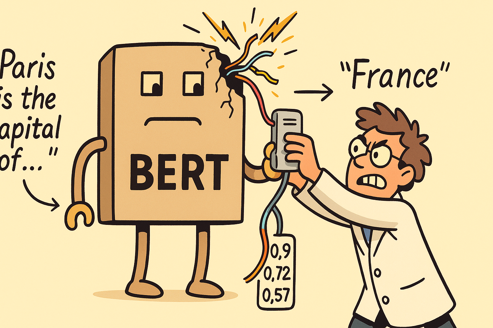
]

.pull-right-narrow[
- *As a happy coincidence, this is how neural networks work internally anyway!* (At least it's one way of understanding it)
]

---
# Embeddings: The idea
.pull-left[
- Encode language such that semantics is encoded in vector operations
- Embedding vectors can be manipulated algebraically
- Example: `Emb(King) - Emb(Man) + Emb(Woman) = Emb(Queen)`
]

.pull-right[
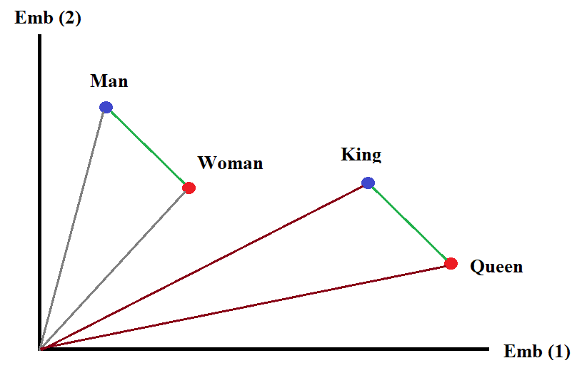
]

---
class: middle
# .red[Practice 2: Cosine similarity by hand]

.pull-left-wide[
1. Compute the cosine similarity of "the stock rose" and "the stock fell" with a document term matrix. What is the problem?
2. Would an embedding model solve the problem? Hint: in which contexts do "rose" and "fell" appear?
]

```{r practice2_answers, eval=FALSE, include=FALSE}
# 1. Vocabulary (fell, rose, stock, the): [0,1,1,1] and [1,0,1,1]
#    -> dot product 2, lengths sqrt(3) -> 2 / 3 = 0.67.
#    Opposite news, same similarity as "he is happy" vs "he is sad": the DTM only counts shared words.
# 2. Only partly. "rose" and "fell" appear in the same contexts (prices, stocks), so their
#    embeddings are often close. Embeddings capture topic well, and polarity less well.
#    This is why sentiment needs a classifier on top (Lecture 3).
```

---
# Example: 10 problems (from earlier)

.small123[
.pull-left[
```{python}
import spacy
from scipy.spatial.distance import cosine

# Load the SpaCy language model
nlp = spacy.load("en_core_web_lg")

# Define the word pairs
word_pairs = [
    ("Silent", "Quiet"),
    ("Wealthy", "Affluent"),
    ("Start", "Commence"),
    ("Help", "Assist"),
    ("Angry", "Furious"),
    ("Happy", "Joyful"),
    ("Big", "Enormous"),
    ("Small", "Tiny"),
    ("Tired", "Exhausted"),
    ("Friend", "Companion")
]

```
]
]

.small123[
.pull-right[
```{python, eval=FALSE}
# Compute cosine distances for each pair
results = []
for word1, word2 in word_pairs:
    vector1 = nlp(word1.lower()).vector.get()
    vector2 = nlp(word2.lower()).vector.get()
    similarity = cosine(vector1, vector2)
    results.append((word1, word2, similarity))
    
# Display results
for word1, word2, distance in results:
    print(f"{word1} ↔ {word2}: {distance:.4f}")

```
Silent ↔ Quiet: 0.3710
Wealthy ↔ Affluent: 0.2438
Start ↔ Commence: 0.5251
Help ↔ Assist: 0.2856
Angry ↔ Furious: 0.2560
Happy ↔ Joyful: 0.4107
Big ↔ Enormous: 0.3416
Small ↔ Tiny: 0.2006
Tired ↔ Exhausted: 0.2935
Friend ↔ Companion: 0.5322
]
]

---
# Looking in the top 10 (see notebook version of slides)
```{python}
import spacy
import numpy as np

nlp = spacy.load("en_core_web_lg")

word_pairs = [
    ("Silent", "Quiet"),
    ("Wealthy", "Affluent"),
    ("Start", "Commence"),
    ("Help", "Assist"),
    ("Angry", "Furious"),
    ("Happy", "Joyful"),
    ("Big", "Enormous"),
    ("Small", "Tiny"),
    ("Tired", "Exhausted"),
    ("Friend", "Companion")
]

def top_similar_words(word, topn=10):
    """Return topn most similar words to `word` from spaCy's vocab."""
    vectors = nlp.vocab.vectors

    # Get the key for the word and its vector
    key = nlp.vocab.strings[word.lower()]
    if key not in vectors.key2row:
        return []

    vec = vectors[key]

    # Decide whether to use numpy or cupy based on the underlying storage
    try:
        import cupy as cp
        xp = cp if isinstance(vectors.data, cp.ndarray) else np
    except ImportError:
        xp = np

    # Build a (1, dim) query array in the right backend (np or cp)
    query = xp.asarray([vec])

    # Ask spaCy for the most similar vectors
    # returns (keys, rows, scores); first result is the word itself (similarity ~1.0)
    keys, rows, scores = vectors.most_similar(query, n=topn + 1)

    similar = []
    for k, s in zip(keys[0][1:], scores[0][1:]):  # skip the word itself
        similar_word = nlp.vocab.strings[int(k)]
        similar.append((similar_word, float(s)))

    return similar


# Print top-10 neighbours for each LEFT word in your pairs
for left, right in word_pairs:
    sims = top_similar_words(left, topn=10)
    print(f"\nTop 10 neighbours for '{left}':")
    for w, score in sims:
        print(f"  {w:<20} {score:.4f}")

```


---
class: middle
# Example: Farther - Man + Woman = Mother?
.small-123[
```{python eval=FALSE}
import spacy

# Load the SpaCy language model
nlp = spacy.load("en_core_web_lg")

# Vectors for the terms
vector_king = nlp("father").vector
vector_man = nlp("man").vector
vector_woman = nlp("woman").vector

# Perform the vector arithmetic
result_vector = vector_king - vector_man + vector_woman

# Find the closest word to the result vector
similar_words = nlp.vocab.vectors.most_similar(result_vector.reshape(1, -1), n=5)

# Output the closest words
for word_id, similarity in zip(similar_words[0][0], similar_words[2][0]):
    word = nlp.vocab.strings[word_id]
    print(f"{word}: {similarity:.4f}")
```
]

---
class: middle
# Example: Farther - Man + Woman = Mother?
### Result
```{python eval=FALSE}
mother: 0.8018
father: 0.7496
grandmother: 0.7310
birthmother: 0.7258
daugther: 0.7162
```

---
class: middle
# Example: Paris - France + Italy = Rome?
.small-123[
```{python eval=FALSE}
import spacy

# Load the SpaCy language model
nlp = spacy.load("en_core_web_lg")

# Vectors for the terms
vector_paris = nlp("Paris").vector
vector_france = nlp("France").vector
vector_italy = nlp("Italy").vector

# Perform the vector arithmetic
result_vector = vector_paris - vector_france + vector_italy

# Find the closest word to the result vector
similar_words = nlp.vocab.vectors.most_similar(result_vector.reshape(1, -1), n=5)

# Output the closest words
for word_id, similarity in zip(similar_words[0][0], similar_words[2][0]):
    word = nlp.vocab.strings[word_id]
    print(f"{word}: {similarity:.4f}")
```
]

---
class: middle
# Example: Paris - France + Italy = Rome?
### Result:
```{python eval=FALSE}
Paris: 0.7084
Milan: 0.6993
Bologna: 0.6938
Rome: 0.6836
Venice: 0.6710
```

---
class: middle
# Example: King - Man + woman = Queen?
.small-123[
```{python eval=FALSE}
import spacy

# Load the SpaCy language model
nlp = spacy.load("en_core_web_lg")

# Vectors for the terms
vector_king = nlp("king").vector
vector_man = nlp("man").vector
vector_woman = nlp("woman").vector

# Perform the vector arithmetic
result_vector = vector_king - vector_man + vector_woman

# Find the closest word to the result vector
similar_words = nlp.vocab.vectors.most_similar(result_vector.reshape(1, -1), n=20)

# Output the closest words
for word_id, similarity in zip(similar_words[0][0], similar_words[2][0]):
    word = nlp.vocab.strings[word_id]
    print(f"{word}: {similarity:.4f}")
```
]

---
class: middle
# Example: King - Man + woman = Queen?
### Result:
.pull-left[.small123[
```{python eval=FALSE}
1. king: 0.8490
2. kings: 0.7189
3. princes: 0.7097
4. consort: 0.7074
5. princeling: 0.7026
6. monarch: 0.6899
7. princelings: 0.6873
8. princesses: 0.6814
9. prince: 0.6563
10. kingship: 0.6498
```
]
]
.pull-right[.small123[
```{python eval=FALSE}
11. princess: 0.6481
12. ruler: 0.6450
13. consorts: 0.6377
14. kingi: 0.6362
15. princedom: 0.6355
16. rulers: 0.6347
17. kingii: 0.6259
18. enthronement: 0.6236
19. monarchical: 0.6206
*20. queen: 0.6178
```
]
]


---
class: middle
# Why does the arithmetic work? Meaning lives in directions

.pull-left-wide[
- King $-$ Man $+$ Woman works because "gender" is (roughly) one **direction** in the space
- [Gurnee & Tegmark (2023)](https://arxiv.org/abs/2310.02207) look for directions for *space* and *time* inside Llama-2
  + Inputs: names of places, historical figures, artworks and **news headlines**
  + A **linear probe** (a plain linear regression on the model's activations) predicts latitude, longitude and *year*
  + Larger models give more accurate maps and timelines
- For us: an embedding of a news article "knows" roughly when it was written
  + Useful: time is a feature you get for free
  + Dangerous: a model can recognise the era of a text in a backtest
]

.pull-right-narrow[
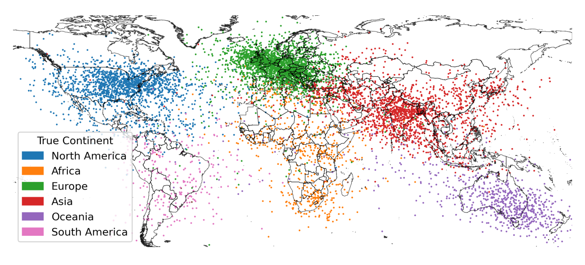
.small123[
*Figure 1 from [Gurnee & Tegmark (2023)](https://arxiv.org/abs/2310.02207)*
]
]

---
class: middle
# Different models, same map?

.pull-left-wide[
- **The Platonic Representation Hypothesis** ([Huh et al., 2024](https://arxiv.org/abs/2405.07987))
- How to compare two models with different dimensions? Compare **neighbours**:
  + Embed the same inputs in model A and model B
  + For each input, find its $k$ nearest neighbours in each model
  + Alignment = overlap of the two neighbour sets
- Findings
  + Better (larger) models are more aligned with each other
  + Language models align with *vision* models, and more so the better they are
  + Interpretation: they converge on one statistical model of the same reality
- For us: if this holds, measures built on nearest neighbours should not depend much on the choice of embedding model. (Testable!)
]

---
class: middle
# More concepts than dimensions: Superposition

.pull-left-wide[
- A 384-dimensional embedding has to represent far more than 384 concepts
- **Toy Models of Superposition** ([Elhage et al., 2022](https://transformer-circuits.pub/2022/toy_model/index.html), Anthropic)
  + Train a tiny network to squeeze $n$ features through $m < n$ dimensions and reconstruct them
  + If features are **sparse** (rarely active together), the model stores more features than dimensions, in almost orthogonal directions
  + The price: **interference**. Activating one feature leaks a little into the others
- Consequences
  + A single dimension (or neuron) rarely means one thing ("polysemantic")
  + Look for meaningful *directions*, not meaningful coordinates
  + Led to sparse autoencoders, used to pull interpretable features out of LLMs
]

.pull-right-narrow[
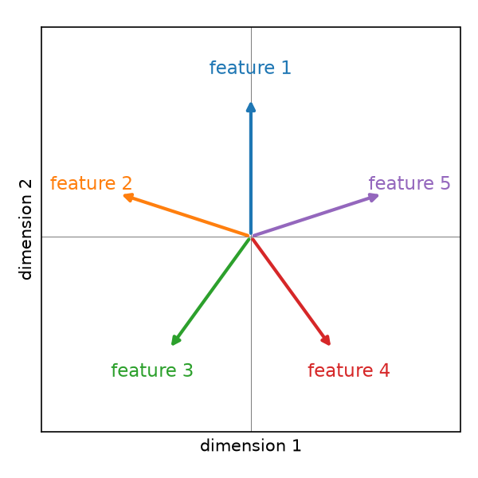
.small123[
*5 sparse features in 2 dimensions. My illustration of the idea in Elhage et al. (2022)*
]
]

---
class: middle
# The simple (extraordinary) function of embedding spaces

.pull-left[
- The embedding representation of a piece of text is a mathematical representation of the ***meaning*** of that piece of text
- This is one way of understanding large language models:
  + Encoder: Encodes the meaning of the input in the embedding space
  + Decoder: Since the meaning is represented, a decoder module can do important stuff with it e.g. predict next word, or classify the input
- But we can also do other kinds of arithmetic with ideas 

]


--

.pull-right[

### Use cases
- Compute measures of innovation 
  + Obvious feature in sentiment stock prediction
- Drastically improve record linking ('John', 'Hans', 'Johannes')
- Build zero-shot classifiers
- Efficiently represent documents for RAG systems
- Cluster documents into topics (Lecture 6)

]


---
class: inverse, middle, center
# Application: Measuring innovation in the news

---
class: middle
# Measuring innovation with embeddings

.pull-left-wide[
- [Koschnick (2025)](https://arxiv.org/abs/2512.16587) (SDU): Did science and applied knowledge feed each other in the run-up to the Industrial Revolution?
  + About 286,000 English book titles 1600–1800, plus patents
  + Embedded with SteamBERTh, a BERT model fine-tuned on historical texts
- Idea: a text is **innovative** if it looks like the *future* of its field more than its *past*
$$\text{Innovation}_i = \frac{f_k(i,\ \text{next } \tau \text{ years})}{f_k(i,\ \text{previous } \tau \text{ years})}$$
  + $f_k$: mean cosine similarity to the $k$ most similar texts in the window
- Most innovative titles in applied physics include Bacon's *Great Instauration* (1620), Boyle on "the spring of the air" (1660) and Kepler's *Dioptrice*
- Validated against patent citations and number of editions
- Python package: [innovfromtext](https://github.com/juliuskoschnick/innovfromtext). On film plots, the top 1970s film is *Star Wars* (1977)
]

---
class: middle
# Innovation in financial news

.pull-left-wide[
- **Data:** 3,168 CNBC articles on S&P 500 firms, 2017–2024 ([KrossKinetic on Hugging Face](https://huggingface.co/datasets/KrossKinetic/SP500-Financial-News-Articles-Time-Series))
- **Embedding:** `all-MiniLM-L6-v2` on the title and the start of each article (no special package: 10 lines with `transformers`)
- **Time unit:** quarters, $\tau = 4$, $k = 10$
- **Two measures** for article $i$ in quarter $t$:
$$\text{Innovation}_i = \frac{f_k(i,\ t+1, \dots, t+4)}{f_k(i,\ t-4, \dots, t-1)}$$
$$\text{Novelty}_i = 1 - f_k(i,\ t-4, \dots, t-1)$$
- Detail: $f_k$ rises with the size of the pool, so every quarter's pool has the same size (60 articles)
]

.footnote[
Code: [Innovation_index_news.py](https://github.com/christianvedels/News_and_Market_Sentiment_Analytics/blob/main/Lecture%204%20-%20Tokenization%20and%20embeddings/Code/Innovation_index_news.py)
]

---
class: middle
# Implementation: the core in 15 lines

.small123[
```{python eval=FALSE}
import torch
from transformers import AutoTokenizer, AutoModel
name = "sentence-transformers/all-MiniLM-L6-v2"
tok, model = AutoTokenizer.from_pretrained(name), AutoModel.from_pretrained(name)

def embed(texts):
    batch = tok(texts, padding=True, truncation=True, max_length=256, return_tensors="pt")
    with torch.no_grad():
        h = model(**batch).last_hidden_state            # one vector per token
    mask = batch["attention_mask"].unsqueeze(-1)        # ignore padding tokens
    v = (h * mask).sum(1) / mask.sum(1)                 # average over tokens
    return torch.nn.functional.normalize(v, dim=1)      # length 1: dot product = cosine

def f_k(Q, P, k=10):                                    # mean of the k highest similarities
    return (Q @ P.T).topk(k, dim=1).values.mean(1)

E_now, E_past, E_future = embed(texts_now), embed(texts_past), embed(texts_future)
novelty    = 1 - f_k(E_now, E_past)
innovation = f_k(E_now, E_future) / f_k(E_now, E_past)
```
]

---
class: middle
# Worked example: Regeneron, 2020Q1

.pull-left-wide[.small123[
**"Regeneron CEO hopes to have coronavirus treatment ready for human testing possibly by this summer"**

| Pool | Nearest articles (k = 3 for readability) | Cosine |
|---|---|---|
| Past | 2019Q1 Sanofi, Regeneron lose US patent challenge to Amgen's cholesterol drug | 0.47 |
| Past | 2019Q2 Human lifespan could soon pass 100 years thanks to medical tech, says BofA | 0.42 |
| Past | 2019Q1 Medtronic CEO pushes back on critics who claim ... | 0.39 |
| Future | 2020Q2 Regeneron sees 'a lot of reason for hope' as human testing of its coronavirus drug begins | 0.80 |
| Future | 2020Q4 Regeneron beats profit estimates as easing pandemic curbs lift eye drug sales | 0.74 |
| Future | 2020Q4 Regeneron requests emergency use approval for antibody treatment taken by Trump | 0.73 |
]]

.pull-right-narrow[
$f_3(\text{past}) = 0.43$

$f_3(\text{future}) = 0.75$

**Novelty** $= 1 - 0.43 = 0.57$

**Innovation** $= 0.75 / 0.43 = 1.76$

.small123[
Code: [Innovation_worked_examples.py](https://github.com/christianvedels/News_and_Market_Sentiment_Analytics/blob/main/Lecture%204%20-%20Tokenization%20and%20embeddings/Code/Innovation_worked_examples.py)
]
]

---
class: middle
# Early, odd one out, late

.pull-left-wide[
| Article | $f_3$ past | $f_3$ future | Novelty | Innovation |
|---|---|---|---|---|
| **Early:** Regeneron hopes for coronavirus treatment by summer (2020Q1) | 0.43 | 0.75 | 0.57 | **1.76** |
| **Odd one out:** Queen Elizabeth's coffin reaches Windsor chapel (2022Q3) | 0.16 | 0.14 | **0.84** | 0.91 |
| **Late:** Regeneron's antibody cocktail is effective in preventing Covid (2021Q1) | 0.83 | 0.50 | 0.17 | 0.60 |
]

.pull-right-narrow[
- Early: unlike the past, like the future
- Odd one out: unlike anything
- Late: the story has peaked. The past is full of it, and the news moves on
]

---
class: middle
# .red[Practice 3: Back of the envelope]

.pull-left-wide[
Two articles from 2023Q1, with **made-up** cosine similarities to their 3 nearest articles:

| Article | Past top 3 | Future top 3 |
|---|---|---|
| A: "ChatGPT reaches 100 million users" | 0.40, 0.35, 0.30 | 0.70, 0.65, 0.60 |
| B: "Microsoft beats earnings estimates" | 0.80, 0.78, 0.76 | 0.80, 0.79, 0.75 |

1. Compute novelty and innovation for A and B
2. When could each of the four numbers have been computed?
3. Can an article be novel but not innovative? Give an example from the news
]

```{r practice3_answers, eval=FALSE, include=FALSE}
# A: f_past = 0.35, f_future = 0.65 -> novelty = 0.65, innovation = 0.65 / 0.35 = 1.86
# B: f_past = 0.78, f_future = 0.78 -> novelty = 0.22, innovation = 1.00
# 2. Novelty: on the day of publication (only needs the past).
#    Innovation: only after the next 4 quarters of news have been published.
# 3. Yes: e.g. Queen Elizabeth's coffin (2022Q3), novelty 0.84 but innovation 0.91.
#    Unlike the past, but nothing followed it. One-off events, off-topic articles.
```

---
class: middle
# Most innovative vs most novel articles

.pull-left[.small123[
### Highest innovation
- **2020Q1** Regeneron CEO hopes to have coronavirus treatment ready for human testing possibly by this summer
- **2020Q1** Trump says, 'Anybody who wants a test gets a test' after Pence says US can't meet coronavirus testing demand
- **2018Q1** Lululemon CEO left in part because of relationship with female designer at the company
- **2018Q3** Campbell Soup and Third Point urge shareholders to vote for two different boards
- **2020Q2** Gilead to begin human trials for the inhaled version of coronavirus drug remdesivir
]]

.pull-right[.small123[
### Highest novelty
- **2022Q3** Queen Elizabeth's coffin reaches Windsor chapel ahead of burial
- **2023Q1** What is full coverage auto insurance?
- **2018Q3** What anyone can learn from Henry Winkler's 42-year wait for a primetime Emmy
- **2023Q1** Hockey Hall of Famer Bobby Hull, the Golden Jet, dies at 84
- **2018Q3** Pope shifts church teaching on the death penalty, says it's never acceptable
]]

---
class: middle
# Two different things

.pull-left-wide[
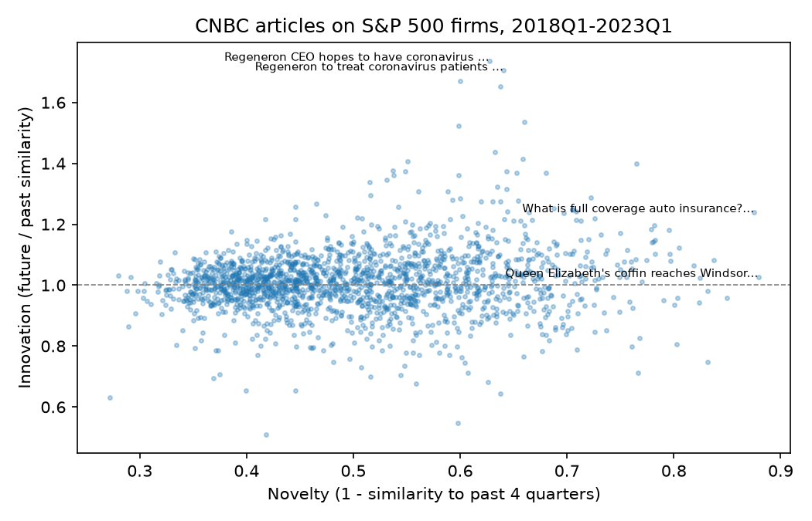
]

.pull-right-narrow[
- Correlation: 0.14
- Novel $\neq$ innovative
- Many novel articles are off-topic: one-offs that nothing follows up on
]

---
<br>
# Why look at stock returns? Step by step

.pull-left-wide[
**The question:** Does the text contain information that is not yet in the price?

**Step 1. Returns, not prices:** $r = \log P_{\text{end}} - \log P_{\text{start}}$ is comparable across firms
]

--

.pull-left-wide[
**Step 2. Abnormal returns:** $AR = r_{\text{firm}} - r_{\text{market}}$ (S&P 500). In March 2020 nearly every stock fell. We want what is specific to the firm
]

--

.pull-left-wide[
**Step 3. Timing:** Start the clock when the article is public. Earlier prices tell us about the news itself, not about what we could have predicted
]

--

.pull-left-wide[
**Step 4. Two targets:** $AR$ is the direction (could we trade on it?). $|AR|$ is the size (does the article matter for the firm?)

**Step 5. Evaluation:** Rank correlation (IC) within each quarter, averaged over quarters. Compares articles from the same time, robust to outliers
]

---
# Measures vs returns (next day)

.panelset[
.panel[.panel-name[All years]
.pull-left-wide[
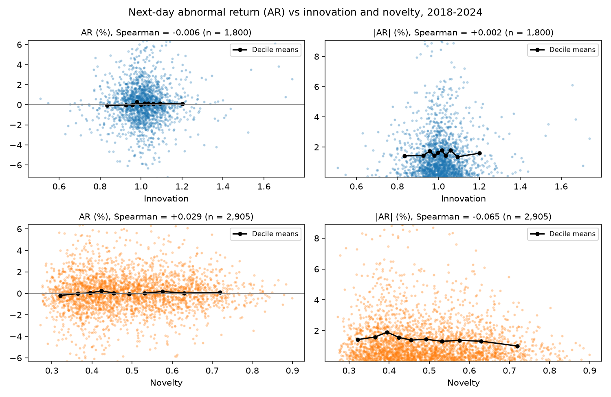
]
.pull-right-narrow[
- Each dot: one article and firm
- Black line: mean return within each decile of the measure
- Left column: nothing on direction
- Bottom right: the more novel the article, the smaller the move
]
]

.panel[.panel-name[2018–2019]
.pull-left-wide[
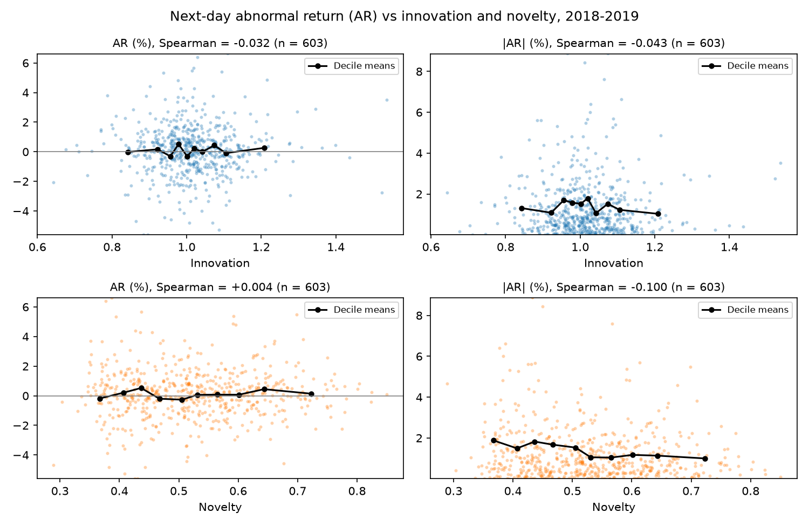
]
.pull-right-narrow[
- Before Covid
- The novelty pattern is strongest here: Spearman −0.10 for the size of the move
]
]

.panel[.panel-name[2020–2021]
.pull-left-wide[
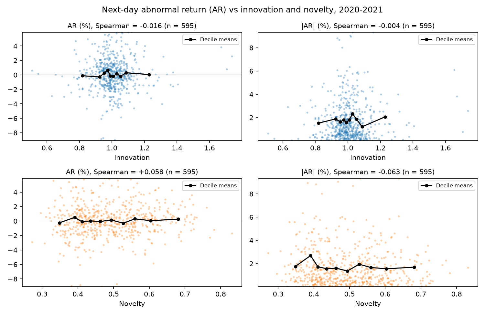
]
.pull-right-narrow[
- Covid
- Novel articles come with slightly *higher* next-day returns (+0.06)
]
]

.panel[.panel-name[2022–2024]
.pull-left-wide[
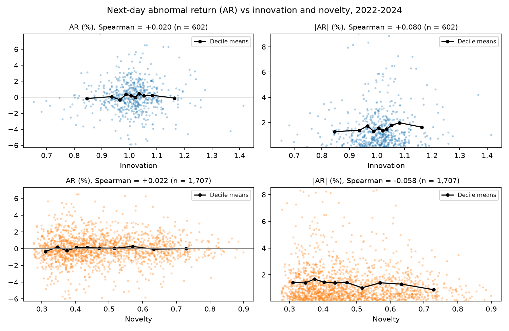
]
.pull-right-narrow[
- Rate hikes, AI boom
- Innovative articles come with *bigger* moves (+0.08)
- Innovation only runs to 2023Q1 here
]
]
]

---
class: middle
# Is there a predictive signal? Next day

.pull-left-wide[
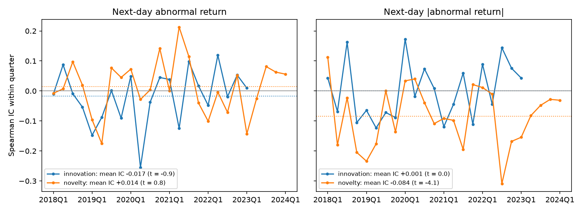
]

.pull-right-narrow[.small123[
- Return of the firm minus the S&P 500 from the close on the publication day to the next close
- **IC:** Spearman correlation between measure and return within each quarter
- t = mean IC / sd × √quarters
- No signal for the direction of returns
- Novel articles are followed by *smaller* moves (t = −4.1)
]]

---
class: middle
# Is there a predictive signal? Next month

.pull-left-wide[
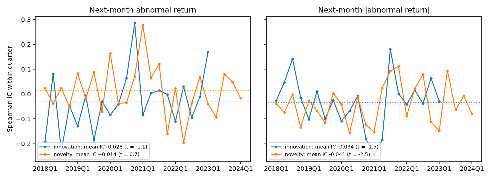
]

.pull-right-narrow[.small123[
- Same, over 21 trading days, starting the day *after* publication
- Still no signal for the direction
- The novelty effect on the size of moves is weaker (t = −2.5)
]]

.footnote[
Code: [Innovation_predictive.py](https://github.com/christianvedels/News_and_Market_Sentiment_Analytics/blob/main/Lecture%204%20-%20Tokenization%20and%20embeddings/Code/Innovation_predictive.py). Prices from Yahoo Finance; 21 of 469 tickers unavailable.
]

---
class: middle
# Plan for the remaining lectures:

### Lecture 5: Causality
### Lecture 6: Record linking and information extraction
### Lecture 7: RAG and tool use, exam launch and course evaluation
### Lecture 8: Practical advice on agentic workflows


---
class: inverse, middle
# Coding challenge: 
## [Building a zero-shot classifier](https://github.com/christianvedels/News_and_Market_Sentiment_Analytics/blob/main/Lecture%204%20-%20Tokenization%20and%20embeddings/Coding_challenge_lecture4.md)


