```{r xaringan-panelset, echo=FALSE}
xaringanExtra::use_panelset()
```

```{r xaringan-tile-view, echo=FALSE}
xaringanExtra::use_tile_view()
```

```{r xaringanExtra, echo = FALSE}
xaringanExtra::use_progress_bar(color = "#808080", location = "top")
```

```{r setup, include=FALSE}
knitr::opts_chunk$set(eval=TRUE, include=TRUE, cache=FALSE)
library(reticulate)
use_condaenv("sentiment2026")
```

```{css echo=FALSE}
.pull-left {
  float: left;
  width: 44%;
}
.pull-right {
  float: right;
  width: 44%;
}
.pull-right ~ p {
  clear: both;
}


.pull-left-wide {
  float: left;
  width: 66%;
}
.pull-right-wide {
  float: right;
  width: 66%;
}
.pull-right-wide ~ p {
  clear: both;
}

.pull-left-narrow {
  float: left;
  width: 30%;
}
.pull-right-narrow {
  float: right;
  width: 30%;
}

.small123 {
  font-size: 0.80em;
}

.tiny123 {
  font-size: 0.65em;
}

.large123 {
  font-size: 2em;
}

.red {
  color: red
}
```

# Last time

.pull-left[
- Tokenization and embedding spaces
- Why vector arithmetic works: meaning lives in directions
- Application: measuring innovation and novelty in financial news
- *Coding challenge:* zero-shot classifier with embeddings
]

.pull-right-narrow[

]

---
class: middle
# Today's lecture

.pull-left-wide[
**Some notion of causality matters for any applied NLP. Today you get the intuition. Other courses give you the formal treatment**

- **Motivation:** Ice cream, drowning and market news
- **Granger causality:** Prediction in time, and why it is not enough
- **Counterfactuals and difference-in-differences (DiD)**
- **Applied:** What DiD tells us about AI (and earlier technology) in the labour market
]

.pull-right-narrow[

]

---
class: inverse, middle, center
# Motivation

---
<br>
# Toy example: Ice cream and drowning

.pull-left[
- Classic summer data set:
  - $X_t$: Ice cream sales
  - $Y_t$: Drowning accidents

- In the toy data: As $X_t$ goes up, $Y_t$ tends to go up

- Question:

  > Does buying ice cream **cause** drowning?

- [Data available here](https://raw.githubusercontent.com/christianvedels/News_and_Market_Sentiment_Analytics/refs/heads/main/Lecture%205%20-%20Causality/Code/icecream_kills.csv)
]

--

.pull-right[
.panelset[
.panel[.panel-name[Plot 1]
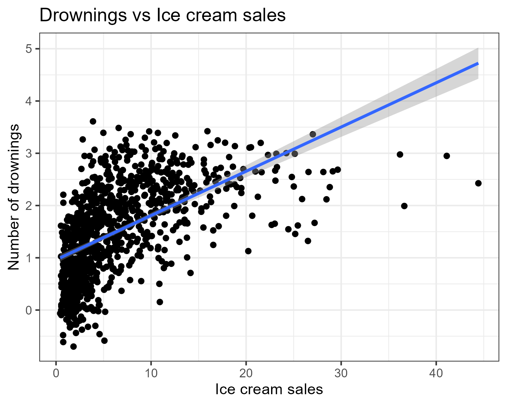
]

.panel[.panel-name[Plot 2]
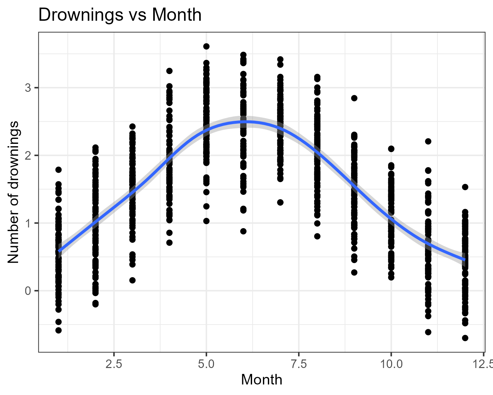
]
]
]

---
# Simple regression results

.pull-left-wide[.small123[
```{python icecream-regression}
import pandas as pd
import statsmodels.formula.api as smf

df = pd.read_csv("Code/icecream_kills.csv")

# (1) Drownings on ice cream sales
m1 = smf.ols("drownings ~ icecream", data=df).fit()
# (2) ... controlling for the month (fixed effects)
m2 = smf.ols("drownings ~ icecream + C(month)", data=df).fit()

for name, m in [("(1) No controls", m1), ("(2) Month FE", m2)]:
    b, se = m.params["icecream"], m.bse["icecream"]
    print(f"{name}: icecream = {b:.3f} (se {se:.3f})")
```
]]

.pull-right-narrow[
- Without controls: ice cream "predicts" drowning
- Within the same month: the effect goes away
- The month (summer!) drives both
]

---
# The same problem in markets

.panelset[
.panel[.panel-name[Liberation Day]
.pull-left-wide[
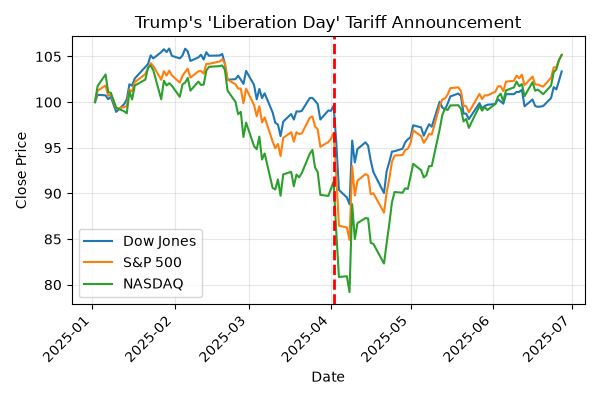
]
.pull-right-narrow[
- **2 April 2025:** Trump announces sweeping "reciprocal" tariffs on almost all US trading partners
- Stocks fall sharply for days; on 9 April most tariffs are paused for 90 days and markets jump

.tiny123[Code: [liberation_day.py](https://github.com/christianvedels/News_and_Market_Sentiment_Analytics/blob/main/Lecture%205%20-%20Causality/Code/liberation_day.py)]
]
]

.panel[.panel-name[Jensen on quantum]
.pull-left-wide[
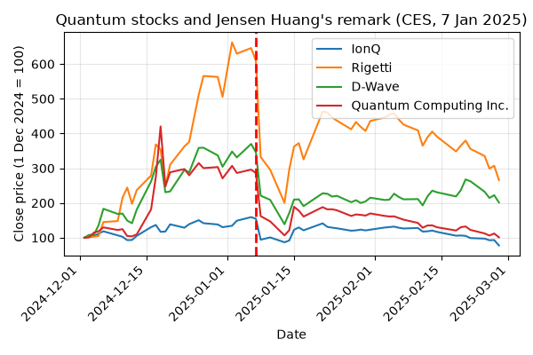
]
.pull-right-narrow[
- **7 January 2025:** Nvidia CEO Jensen Huang says "very useful" quantum computers are 15–30 years away
- Next day, quantum stocks fall 36–45%: more than USD 8 billion in market value gone

.tiny123[Code: [jensen_quantum.py](https://github.com/christianvedels/News_and_Market_Sentiment_Analytics/blob/main/Lecture%205%20-%20Causality/Code/jensen_quantum.py)]
]
]

.panel[.panel-name[Altman: "AI bubble"]
.pull-left-wide[
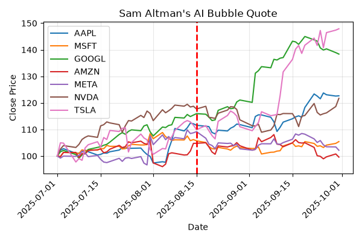
]
.pull-right-narrow[
- **Mid-August 2025:** OpenAI's Sam Altman says investors are "overexcited" about AI, comparing it to a bubble
- A big headline, but no clear reaction in the AI-heavy tech stocks

.tiny123[Code: [technews_and_AI_stocks.py](https://github.com/christianvedels/News_and_Market_Sentiment_Analytics/blob/main/Lecture%205%20-%20Causality/Code/technews_and_AI_stocks.py)]
]
]
]

???
- Each picture invites "news moved the market". Rival stories: prices move news, or something else (macro, liquidity) moves both.

---
class: middle
# Pearl's ladder of causation
### *You cannot move up the ladder without assumptions*

.pull-left-wide[
.pull-left-narrow[
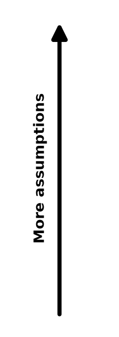
]

.pull-right-wide[
**3. Counterfactuals:** What **would have** happened if ...?

<br>

**2. Intervention:** $P(Y \mid \text{do}(X))$. What happens if we **force** $X$?

<br>

**1. Association:** $P(Y \mid X)$. What tends to go together?
]
]

.pull-right-narrow[
- The regression gives us level 1
- We want level 2 (or 3)
- Today: two ways of climbing
  + **Granger:** Use time
  + **DiD:** Build a counterfactual
]

---
class: inverse, middle, center
# Granger causality: Prediction in time

---
class: middle
# Granger causality: The idea

.pull-left-wide[
> $X$ **Granger-causes** $Y$ if past values of $X$ improve forecasts of $Y$, **beyond** what past $Y$ already tells us

- Compare two regressions (an autoregressive model, AR, with and without lags of $X$):
$$Y_t = a + \sum_{j=1}^{p} b_j Y_{t-j} + \varepsilon_t$$
$$Y_t = a + \sum_{j=1}^{p} b_j Y_{t-j} + \sum_{j=1}^{p} c_j X_{t-j} + \varepsilon_t$$
- Test $H_0: c_1 = \dots = c_p = 0$ with an F-test
- Uses one causal intuition: **causes come before effects**
]

.pull-right-narrow[
For us:
- Does yesterday's news sentiment predict today's return?
- Do yesterday's returns predict today's news?
]

---
class: middle
# Granger in practice: News sentiment and the S&P 500

.pull-left[.small123[
- 806,000 stock headlines, 2010–2020 ([ashraq/financial-news](https://huggingface.co/datasets/ashraq/financial-news))
- Daily mean AFINN sentiment (Lecture 2) vs daily S&P 500 return, 2,587 trading days

| Lags | Sentiment → returns | Returns → sentiment |
|---|---|---|
| 1 | p = 0.80 | p = 0.13 |
| 3 | p = 1.00 | p = 0.12 |
| 5 | p = 0.78 | p = 0.21 |

- Neither direction is significant at daily frequency
- If anything, returns lead the news, not the other way round
]]

.pull-right[
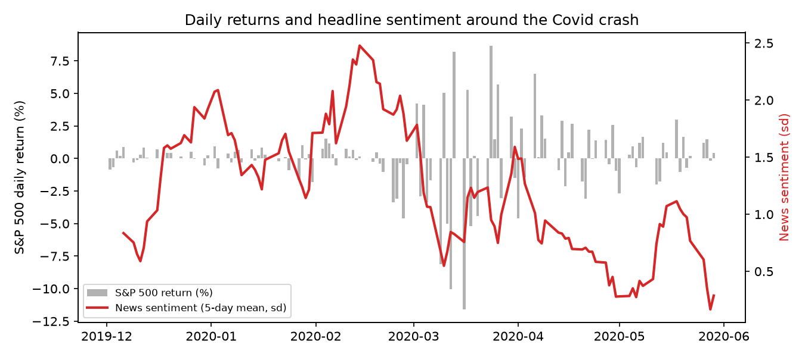
.small123[
Code: [granger_news_returns.py](https://github.com/christianvedels/News_and_Market_Sentiment_Analytics/blob/main/Lecture%205%20-%20Causality/Code/granger_news_returns.py)
]
]

---
<br>
# Why Granger causality falls short

.pull-left-wide[
- **Prediction is not causation.** Christmas card sales Granger-cause Christmas
]

--

.pull-left-wide[
- **Expectations.** Markets price news before it is printed. Returns can Granger-cause news even when the news is what matters
]

--

.pull-left-wide[
- **Common causes with different delays.** A rate decision moves prices today and headlines tomorrow
]

--

.pull-left-wide[
- **Efficient markets.** If sentiment reliably predicted returns, traders would trade it away. No Granger causality does not mean no effect
]

--

.pull-left-wide[
**What we need:** a credible answer to *"what would have happened otherwise?"*
]

---
class: inverse, middle, center
# Counterfactuals and difference-in-differences

---
<br>
# Counterfactuals: What would have happened otherwise?

.pull-left-wide[
> Every causal claim compares what happened with what **would have happened** otherwise: the **counterfactual**
]

--

.pull-left-wide[
- "The tariffs crashed the market" = no crash **without** the tariffs
- "ChatGPT cost young writers jobs" = more jobs **without** ChatGPT
]

--

.pull-left-wide[
- That world never happened. We can **never observe it**
- Causal inference = finding a credible stand-in for it
]

---
<br>
# Potential outcomes: Writing counterfactuals down

.pull-left[
- Two **potential outcomes** per person:
  + $Y(1)$: with AI
  + $Y(0)$: without AI
- Effect: $Y(1) - Y(0)$
- We only ever see one of them
]

--

.pull-right[
| Worker | Uses AI | $Y(1)$ | $Y(0)$ |
|---|---|---|---|
| A | yes | 110 | **?** |
| B | yes | 108 | **?** |
| C | no | **?** | 95 |
| D | no | **?** | 90 |
]

--

.pull-left[
- Naive: $109 - 92.5 = 16.5$. The effect of AI?
- Only if A and B would have earned like C and D without AI
$$\text{Naive} = \text{Effect} + \text{Selection bias}$$
]

---
class: middle
# Two naive comparisons

.pull-left-wide[
**Card & Krueger (1994):** New Jersey raised its minimum wage from USD 4.25 to USD 5.05 an hour in April 1992. Neighbouring Pennsylvania did not. Employment per fast-food restaurant ([NBER w4509](https://www.nber.org/papers/w4509)):

1. **Before vs after in New Jersey:** $21.03 - 20.44 = +0.59$
  + Problem: Everything else that changed in 1992 (the economy, the season)
2. **New Jersey vs Pennsylvania, after:** $21.03 - 21.17 = -0.14$
  + Problem: The two states were different to begin with
]

.pull-right-narrow[
- Each comparison has its own bias
- Idea: Use one to correct the other
]

---
class: middle
# Difference-in-differences: The 2×2

.pull-left[
| FTE per store | Pennsylvania | New Jersey |
|---|---|---|
| Before (Feb 1992) | 23.33 | 20.44 |
| After (Nov 1992) | 21.17 | 21.03 |
| **Change** | **−2.16** | **+0.59** |

$$\text{DiD} = (+0.59) - (-2.16) = +2.75$$

.small123[
Source: Card & Krueger (1994), Table 3 ([NBER w4509](https://www.nber.org/papers/w4509)). The paper reports 2.76 (s.e. 1.36) from unrounded numbers. FTE = full-time-equivalent employees
]
]

.pull-right[
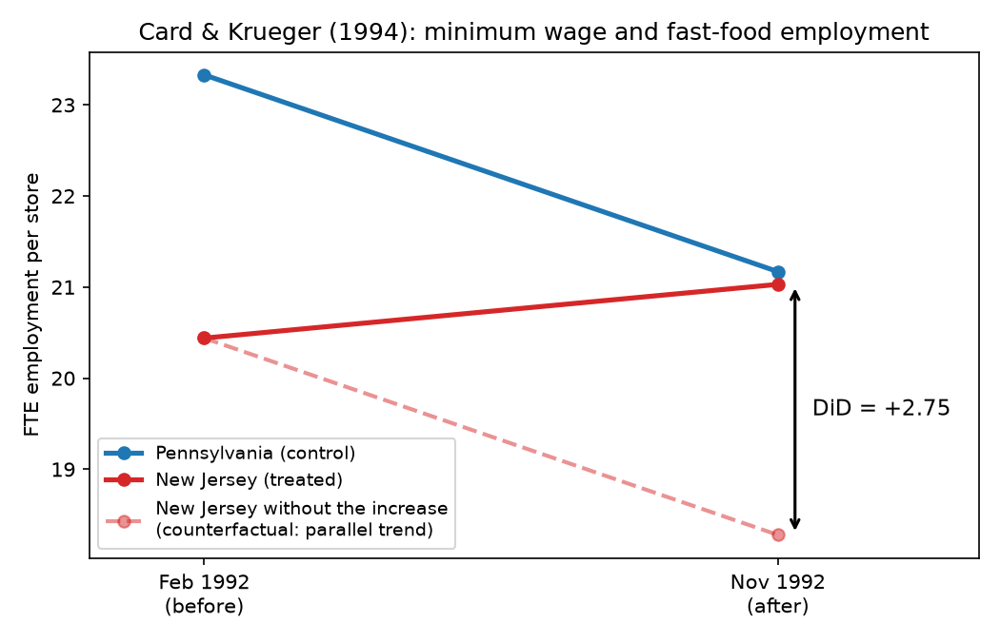
]

---
# Deriving DiD: Realized minus counterfactual

.pull-left-wide[
**Start from:** $\text{Naive} = \text{Effect} + \text{Selection bias}$
]

--

.pull-left-wide[
**After** the increase, New Jersey vs Pennsylvania: $\text{Gap}_{\text{after}} = \text{Effect} + \text{Bias}_{\text{after}}$
]

.pull-right-narrow[
$21.03 - 21.17 = -0.14$
]

--

.pull-left-wide[
**Before**, nobody is treated, so the gap is pure selection: $\text{Gap}_{\text{before}} = \text{Bias}_{\text{before}}$
]

.pull-right-narrow[
$20.44 - 23.33 = -2.89$
]

--

.pull-left-wide[
**Parallel trends:** The bias does not change, $\text{Bias}_{\text{after}} = \text{Bias}_{\text{before}}$. So
$$\text{DiD} = \text{Gap}_{\text{after}} - \text{Gap}_{\text{before}} = \text{Effect}$$
]

.pull-right-narrow[
<br>
$-0.14 - (-2.89) = 2.75$
]

--

.pull-left-wide[
**Same thing:** Realized minus counterfactual for New Jersey, where counterfactual = before + Pennsylvania's change: $20.44 - 2.16 = 18.28$
]

.pull-right-narrow[
$21.03 - 18.28 = 2.75$
]

---
class: middle
# The key assumption: Parallel trends

> **Parallel trends:** Without the treatment, the treated group would have changed by as much as the control group did

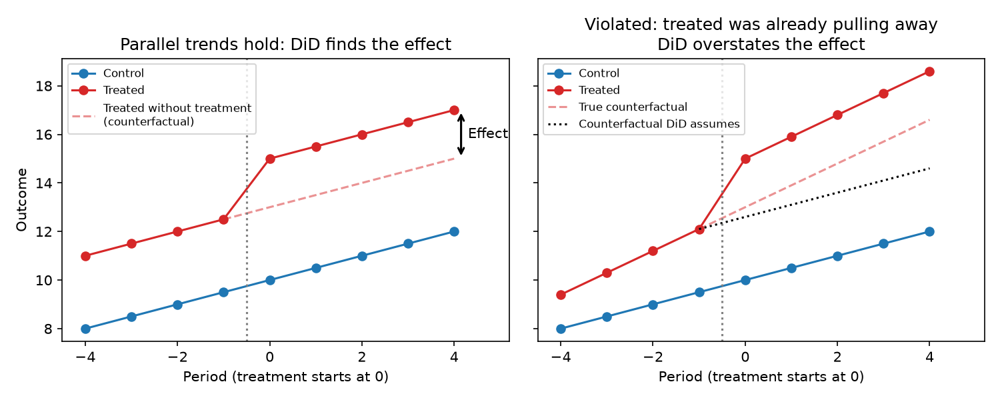

---
class: middle
# Checking parallel trends: Event studies

.pull-left-wide[
- Parallel trends cannot be tested after treatment: That is the missing counterfactual
- But we can look **before** treatment: Did the groups move together then?
- With many periods we plot one DiD per period: an **event-study plot**
  + Before treatment: Estimates near zero (parallel pre-trends)
  + After treatment: The effect, period by period
- Staggered timing (units treated at different dates) is common: Compare the already treated with the not yet treated
- The employment effect of minimum wages is still a hotly debated topic. With other data, [Neumark & Wascher (2000)](https://doi.org/10.1257/aer.90.5.1362) found a negative effect
]

---
class: middle
# .red[Practice 1: DiD by hand]

.pull-left-wide[
A newsroom introduces an AI writing tool in 2023. Another newsroom does not. Articles per journalist per week:

| | 2022 | 2024 |
|---|---|---|
| Newsroom with AI | 10 | 14 |
| Newsroom without AI | 8 | 10 |

1. What is the before/after estimate? And the DiD estimate?
2. The newsroom with AI also hired a new editor-in-chief in 2023. What does that do to the DiD?
3. What would you want to see for 2019–2022 before you trust the estimate?
]

```{r practice1_answers, eval=FALSE, include=FALSE}
# 1. Before/after: 14 - 10 = +4. DiD: (14 - 10) - (10 - 8) = 4 - 2 = +2 articles per week.
# 2. Parallel trends is violated if the new editor changed output by itself: the DiD mixes the
#    AI effect with the editor effect. Not identified without more data.
# 3. Pre-trends: the two newsrooms should have moved in parallel before 2023 (event-study plot
#    with estimates near zero before treatment).
```

---
class: inverse, middle, center
# Applied: What DiD tells us about AI and work

---
class: middle
# Where we are heading: Stylised facts on AI and work

.pull-left-wide[
1. **Large task-level gains, largest for novices.** Writing tasks 40% faster with ChatGPT; customer support +15% per hour, +30% for less skilled and less experienced agents
2. **No economy-wide effect on earnings or hours (yet).** Danish registers rule out effects above 2%
3. **The adjustment hits newcomers.** Young workers (22–25) in AI-exposed jobs: 19% behind, through less hiring. Same pattern for telephone operators (1920s–40s) and bootmakers (1850s–80s)
4. **Old jobs are destroyed, new ones created.** 153,000 artisanal bootmaking jobs disappeared and 140,000 new ones appeared. This is **creative destruction** (2025 Nobel Prize, next slide)
]

.pull-right-narrow[
- Predicting the labour market is very hard
- These facts mostly come from **one** estimator: difference-in-differences
- It rests on one idea: the **counterfactual**
- We return to this slide at the end
]

---
class: middle
# Creative destruction: The 2025 Nobel Prize in Economics

.pull-left[.small123[
**Joel Mokyr, Philippe Aghion and Peter Howitt**, *"for having explained innovation-driven economic growth"* ([press release](https://www.nobelprize.org/prizes/economic-sciences/2025/press-release/))

- **Mokyr** (half the prize): Used history to find the prerequisites for sustained growth. Growth took off when *propositional* knowledge (why things work) and *prescriptive* knowledge (how to make things) fed each other, in a society open to change. Lecture 4: [Koschnick (2025)](https://arxiv.org/abs/2512.16587) measured this feedback with embeddings
- **Aghion & Howitt** (half the prize): A model of **creative destruction** ([Aghion & Howitt, 1992](https://doi.org/10.2307/2951599)). New, better products replace the old ones
  + *Creative:* Growth comes from building on earlier innovation
  + *Destructive:* Old products, firms and skills lose their value
- **Conflict:** Those who lose (incumbent firms, interest groups) may try to block innovation. The conflict has to be managed, or growth stalls
- **Today's papers:** The bootmakers, telephone operators and young workers are the "destruction" side, measured with DiD
]]

.pull-right[
.panelset[
.panel[.panel-name[Creative destruction]
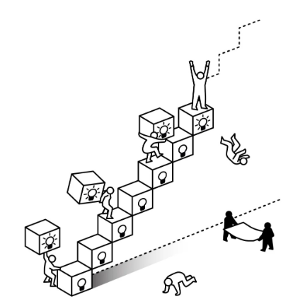
]
.panel[.panel-name[Mokyr]
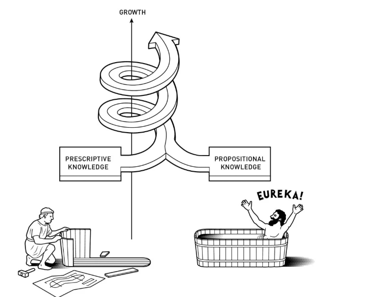
]
]
.tiny123[
Illustrations: ©Johan Jarnestad/The Royal Swedish Academy of Sciences ([popular information](https://www.nobelprize.org/prizes/economic-sciences/2025/popular-information/))
]
]

---
class: middle
# How to read each example

.pull-left-wide[
For every paper, ask the same four questions:

1. **Treated:** Who got the technology?
2. **Control:** Who stands in for the counterfactual?
3. **Timing:** When did it arrive?
4. **The plot:** Flat before? A break after?

We start with a randomised experiment
]

.pull-right-narrow[
- Experiments are rare for whole labour markets
- Hence DiD
]

---
class: middle
# A randomised experiment with ChatGPT

.pull-left-wide[
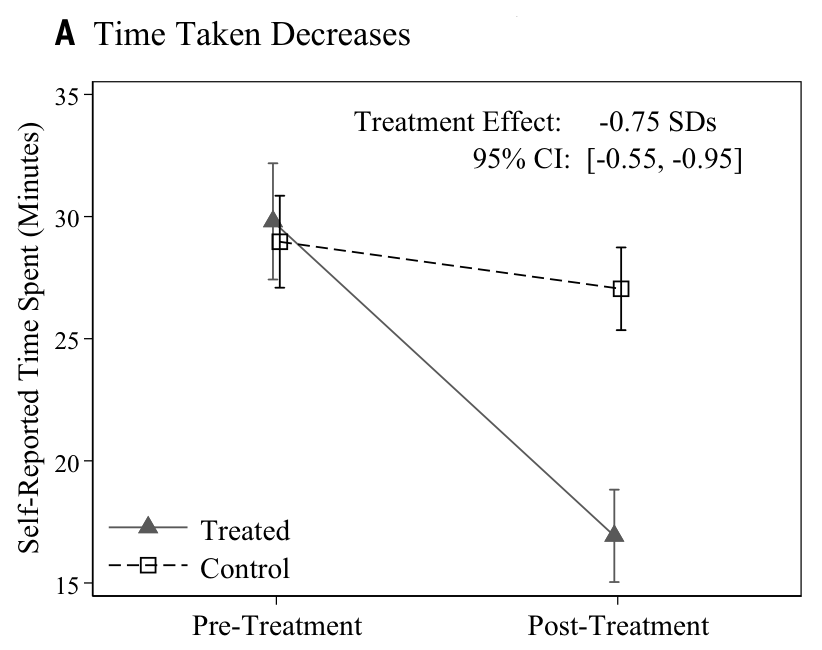
.tiny123[
Figure 1A from [Noy & Zhang (2023)](https://doi.org/10.1126/science.adh2586), *Science* 381(6654)
]
]

.pull-right-narrow[.small123[
- **Treated:** Half of 453 professionals, chosen **at random**, get ChatGPT
- **Control:** The other half: no selection bias
- **Timing:** Between two writing tasks
- **The plot:** Same start; treated diverge after
- **Finding:** 40% less time, 18% higher grades; weaker writers gained most
- But: short, stylised tasks. Real jobs? That is where DiD comes in
]]

---
class: middle
# AI in customer support: Staggered rollout

.pull-left[
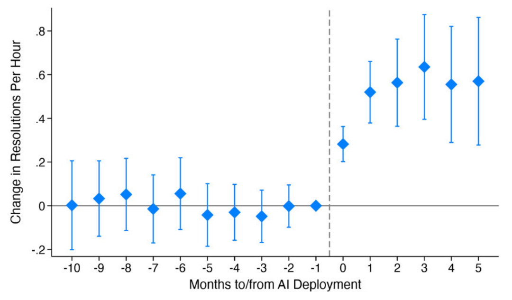
.tiny123[
Figure II from [Brynjolfsson, Li & Raymond (2025)](https://doi.org/10.1093/qje/qjae044), *Quarterly Journal of Economics* 140(2). Baseline: about 2.4 resolutions per hour
]
]

.pull-right[
- **Treated:** 5,172 support agents getting an AI assistant
- **Control:** Agents not yet given access
- **Timing:** Rollout at different dates
- **The plot:** Flat for 10 months before, a jump at month 0
- **Finding:** +15% issues resolved per hour; +30% for less skilled and less experienced agents; the most experienced gain a little speed and lose a little quality
]

---
class: middle
# Young workers: "Canaries in the coal mine"

.pull-left-wide[
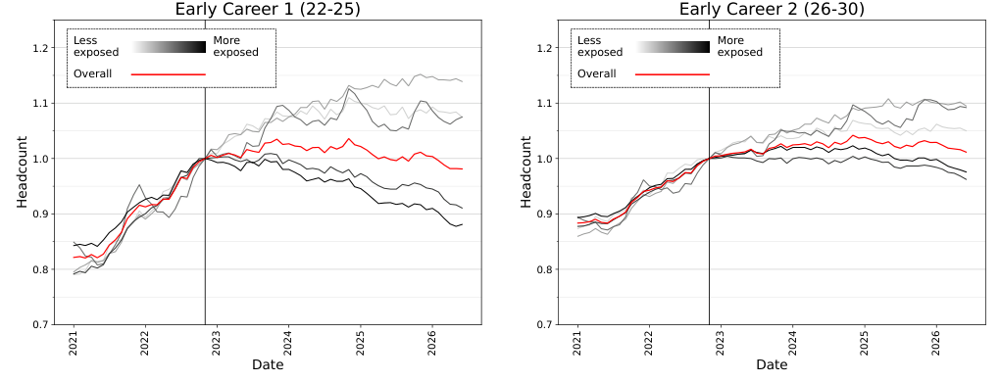
.tiny123[
Figure 3 from [Brynjolfsson, Chandar & Chen (2026)](https://digitaleconomy.stanford.edu/publication/canaries-in-the-coal-mine/), Stanford Digital Economy Lab working paper (August 2026 version). Headcount normalised to 1 in November 2022; darker lines are more AI-exposed occupations
]
]

.pull-right-narrow[
- **Treated:** 22–25-year-olds in the most AI-exposed occupations (ADP payroll data)
- **Control:** Less exposed occupations, and older workers
- **Timing:** ChatGPT, November 2022
- **Finding:** 19% behind their less exposed peers by June 2026, through **less hiring**, not firing
]

---
class: middle
# Denmark: Precise zeros on earnings

.pull-left[
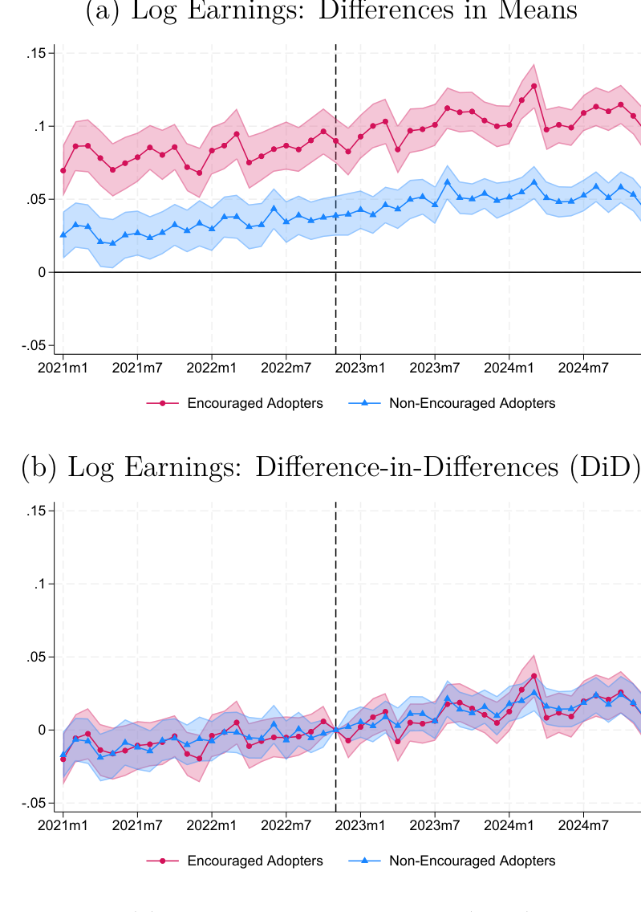
.tiny123[
Figure 5 from [Humlum & Vestergaard (2025)](https://www.nber.org/papers/w33777), NBER w33777
]
]

.pull-right[
- **Treated:** Workers who adopted AI chatbots (surveys of 25,000 workers linked to Danish registers)
- **Control:** Non-adopters in the same occupations
- **Timing:** ChatGPT, November 2022
- **Panel (a):** Adopters earn more, before *and* after. That is selection, not an effect
- **Panel (b):** The DiD is flat. Effects above 2% ruled out two years on
- Work changes (new tasks, job switches), pay does not (yet)
]

---
class: middle
# History I: Telephone operators, 1920–1940

.pull-left-wide[
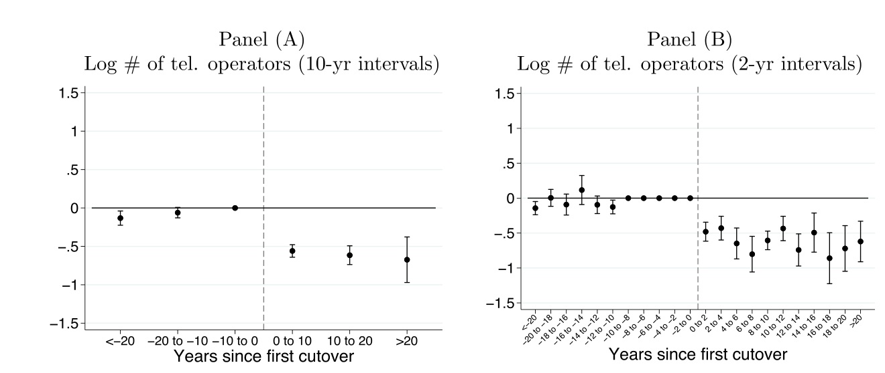
.tiny123[
Figure III from [Feigenbaum & Gross (2024)](https://doi.org/10.1093/qje/qjae005), *Quarterly Journal of Economics* 139(3). Log number of young women working as telephone operators
]
]

.pull-right-narrow[.small123[
- **Treated:** US cities switching to dial exchanges
- **Control:** Cities not yet switched
- **Timing:** Staggered cutovers, 1920–1940
- **The plot:** Flat before, then a large, lasting drop
- **Finding:** Later cohorts' total employment held up (clerical and service jobs). Incumbent operators did worse
]]

---
class: middle
# History II: Bootmakers and the sewing machine, 1851–1911

.pull-left[
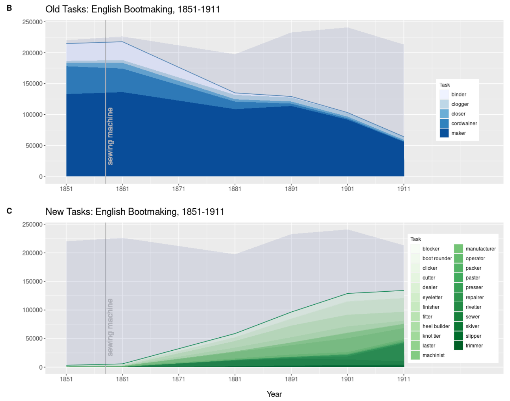
.tiny123[
Figure 1 (B, C) from [Vipond (2026)](https://www.hillaryvipond.com/assets/files/Vipond_TechnologicalUnemployment_VictorianBritain.pdf), working paper. Old tasks (blue) vs new tasks (green)
]
]

.pull-right[.small123[
- **Data:** 170 million linked British census records
- **Comparison:** Bootmakers vs other trades, before and after the sewing machine (1857)
- 153,000 artisanal jobs disappeared, 140,000 new ones appeared
- Incumbent artisans were **not** pushed out. Instead, entry collapsed:

| Entry into artisanal bootmaking | 1851–61 | 1861–81 |
|---|---|---|
| Young men | 3.08% | 1.81% |
| Young women | 0.75% | 0.08% |

- About 45% of the new jobs were in two counties
]]

---
class: middle
# Back to the stylised facts

.pull-left-wide[
1. **Large task-level gains, largest for novices:** Experiment ([Noy & Zhang](https://doi.org/10.1126/science.adh2586)) and staggered DiD ([Brynjolfsson, Li & Raymond](https://doi.org/10.1093/qje/qjae044))
2. **No economy-wide effect on earnings or hours (yet):** DiD on Danish registers ([Humlum & Vestergaard](https://www.nber.org/papers/w33777))
3. **The adjustment hits newcomers:** Exposure-based event study ([Brynjolfsson, Chandar & Chen](https://digitaleconomy.stanford.edu/publication/canaries-in-the-coal-mine/), descriptive) and history ([Feigenbaum & Gross](https://doi.org/10.1093/qje/qjae005); [Vipond](https://www.hillaryvipond.com/assets/files/Vipond_TechnologicalUnemployment_VictorianBritain.pdf))
4. **Old jobs are destroyed, new ones created:** Creative destruction ([Aghion & Howitt, 1992](https://doi.org/10.2307/2951599); 2025 Nobel Prize), seen in the bootmakers and telephone operators
]

.pull-right-narrow[
- Every fact rests on a counterfactual
- Each is only as good as its parallel-trends assumption
- **For markets:** Is the AI trade a good idea in the long run? It depends on whether these gains show up in output and profits
]

---
class: middle
# .red[Practice 2: Read a DiD yourself]

.pull-left-wide[.small123[
In groups, take one study. Open the paper and find the main DiD or event-study figure.

- **A:** Akerman, Gaarder & Mogstad, [working paper (NBER w20826)](https://www.nber.org/papers/w20826); published in the *Quarterly Journal of Economics* (2015). Norwegian workers and firms as a public program rolled out broadband internet
- **B:** Hjort & Poulsen, [working paper (NBER w23582)](https://www.nber.org/papers/w23582); published in the *American Economic Review* (2019). Employment in Africa as submarine internet cables reached the coast

.footnote[.small123[
*Working paper vs published:* A working paper (WP) is the authors' free, public draft. The published version has passed peer review (other researchers checked it before the journal accepted it). Read the published version: it is more trustworthy. If you do not have institutional access, the WP is usually fine.
]]

1. Who is treated, who is the control, and when does treatment start?
2. What is the headline estimate, in words?
3. Do the pre-trends look parallel? What else happened at the same time?
4. **Your opinion:** Would you bet on this effect? What would change your mind?
5. Which of today's stylised facts does it support, nuance or contradict?
]]

```{r practice2_answers, eval=FALSE, include=FALSE}
# A: Treated = firms/workers in areas where broadband access points arrived; control = areas
#    not yet covered; timing = the public program's rollout (2000s). Broadband raised labour
#    market outcomes and productivity of skilled workers and worsened those of unskilled workers
#    (complements nonroutine abstract tasks, substitutes routine tasks). Threat: rollout order
#    may follow local demand or growth; check pre-trends. Nuances the facts: unlike early gen-AI
#    evidence (largest gains for novices), this technology favoured the already skilled.
# B: Treated = locations connected to the terrestrial backbone as submarine cables arrive;
#    control = nearby, unconnected locations; staggered arrival 2000s-2010s. Large positive
#    employment effects, driven by higher-skill jobs, little displacement across space.
#    Contrasts with today's AI facts: a technology that creates jobs on net. Threat: the
#    backbone was built where growth was expected anyway (check pre-trends).
```

---
# Before next time

.pull-left[
- Coding challenge 5 (below)
- Next time: Linking and extracting. From text to tables: record linking, structured extraction and topic modelling $\rightarrow$ Chapter 8
- Want more causal inference? Cunningham (2021), *Causal Inference: The Mixtape*
]

.pull-right-narrow[

]

---
class: inverse, middle
# Coding challenge:
## [News and Market Sentiment Analysis](https://github.com/christianvedels/News_and_Market_Sentiment_Analytics/blob/main/Lecture%205%20-%20Causality/coding_challenge_5.md)

---
name: appendix
class: middle, center, appendix

# Appendix: Directed acyclic graphs (DAGs)

---
class: middle
# Enter DAGs

.pull-left-wide[
- A **Directed Acyclic Graph (DAG)**:
  - Nodes = variables
  - Arrows = causal influence

- For ice cream:
  - $M \rightarrow X$
  - $M \rightarrow Y$
  - No arrow $X \rightarrow Y$

- *Lacking arrows encode our assumptions*
]

.pull-right-narrow[
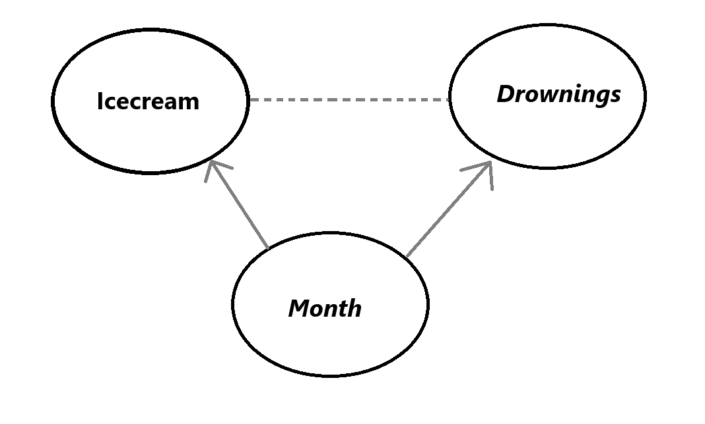
]

---
class: middle
# Canonical structures

.pull-left[
1. **Chain** (mediator)

   $$X \rightarrow Z \rightarrow Y$$

2. **Fork** (common cause)

   $$X \leftarrow Z \rightarrow Y$$

3. **Collider** (common effect)

   $$X \rightarrow Z \leftarrow Y$$
]

.pull-right-narrow[
- Ice cream example:

  $$X \leftarrow M \rightarrow Y$$

- This is a **fork**:
  - $M$ causes both $X$ and $Y$
  - Confounding if $M$ is ignored
]

---
class: middle
# Central trick

> *Under some conditions we can estimate $P(Y \mid \text{do}(X))$ from observational quantities.*

.pull-left-wide[
- Idea: **block the backdoor paths** from $X$ to $Y$
- Find a set of variables $Z$ such that $Z$ d-separates $X$ and $Y$ when we ignore arrows **out of** $X$
- Then we can identify:

  $$P(Y \mid \text{do}(X)) = \sum_z P(Y \mid X, Z=z)\,P(Z=z)$$

- Ice cream example: $Z = \{M\}$ (month). Controlling for $M$ removes the spurious $X \leftarrow M \rightarrow Y$ path
]

---
class: middle
# d-separation (graphical independence)

.pull-left[
$X$ and $Y$ are d-separated by $Z$ if **every path** between them is **blocked** when we condition on $Z$.

.small123[
- **Chain / fork:** $X \rightarrow M \rightarrow Y$ or $X \leftarrow M \rightarrow Y$. Blocked if we **condition on** $M$
- **Collider:** $X \rightarrow M \leftarrow Y$. Blocked if we do **not** condition on $M$ (or a descendant). Conditioning on a collider **opens** the path
]
]

.pull-right-narrow[
> d-separated nodes are conditionally independent: $X \perp Y \mid Z$

> *Guides us in choosing adjustment sets*
]

---
class: middle
# Exercise: Mediator (chain)

.pull-left[
- $X$: Surprisingly good inflation numbers
- $M$: Investor optimism
- $Y$: Stock index return

1. Draw a DAG for $(X, M, Y)$
2. Are $X$ and $Y$ d-separated (a) given nothing, (b) given $M$?
]

.pull-right-narrow[
- If we **adjust for** $M$, do we get the effect of $X$ on $Y$?
]

???
- Chain X -> M -> Y. (a) Not d-separated. (b) d-separated by M: adjusting for a mediator blocks the total effect.

---
class: middle
# Exercise: Collider

.pull-left-wide[
- $X$: True product quality
- $Y$: Marketing spend
- $Z$: "Featured on TechNews front page"

Editors feature firms that are very high quality **or** very heavy on marketing.

- Among featured firms, does more marketing go with worse products? Is that causal?
]

???
- X -> Z <- Y. Conditioning on Z = 1 induces a negative correlation between X and Y (selection on a collider).

---
class: middle
# Where to read more

.pull-left-wide[
- Judea Pearl (2009): *Causality* (technical)
- Pearl, Glymour & Jewell (2016): *Causal Inference in Statistics: A Primer* (intro)
- Judea Pearl (2018): *The Book of Why* (popular science)
- Scott Cunningham (2021): *Causal Inference: The Mixtape* (applied economics; covers DiD)
]
